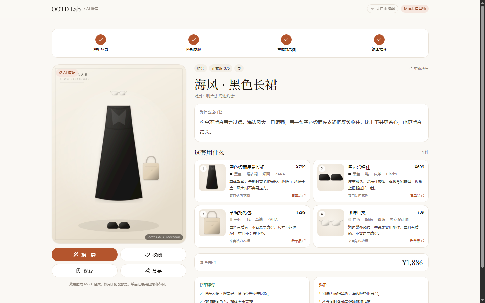
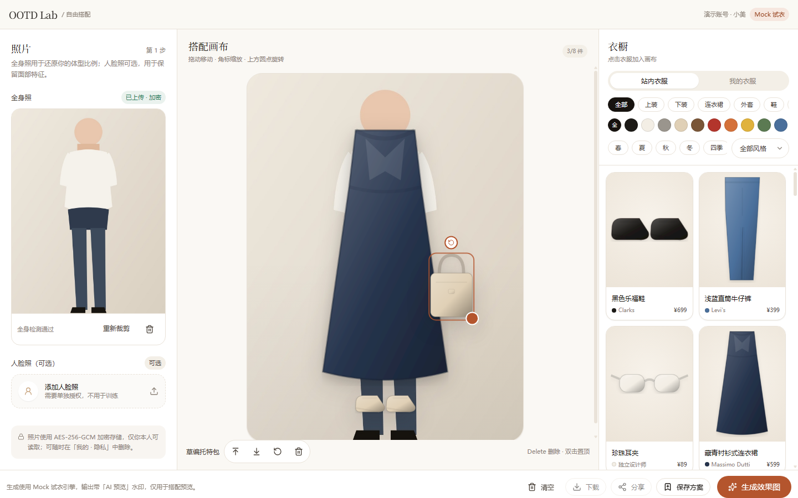
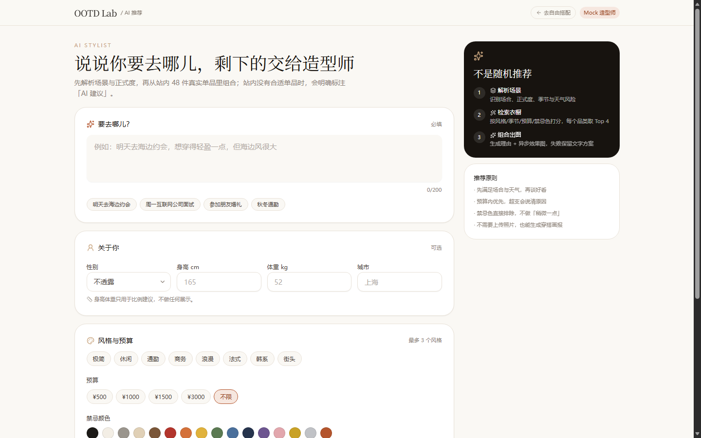
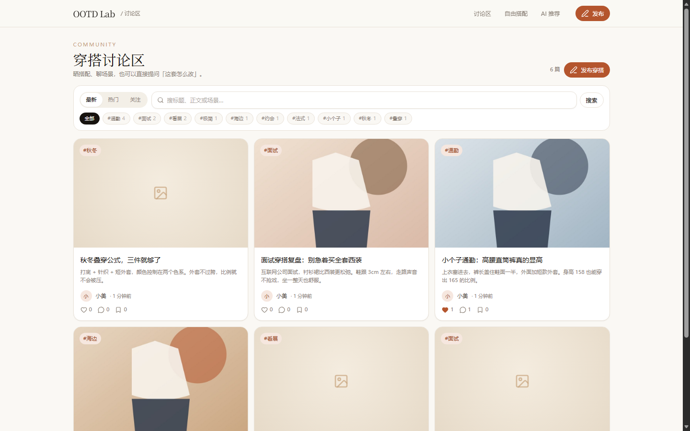

# OOTD Lab · 穿搭实验室

> AI 穿搭推荐网站：上传一张照片，用站内衣橱或自己的衣服，生成"穿在你身上"的全身效果图；也可以只描述场景，让 AI 从真实衣橱里推荐一套并说明理由。

**当前进度：自由搭配（`/outfit-studio`）+ AI 推荐（`/ai-recommend`）+ 讨论区（`/community`）端到端可运行**，零第三方 Key、零 Docker 依赖。

> **验收状态**：功能验收 7/7 通过；安全基础已补齐（真实登录、限流、face/body 同意、删除/导出/撤回、签名 URL、分享公开副本、Origin/SSRF、审计）。**仍剩**：图片审核真实 Provider + 管理后台、任务编排统一、S3 生产驱动。详见 [安全加固记录](docs/15-security-hardening.md)、[验收测试计划](docs/13-acceptance-test-plan.md)。
>
> **公网部署**：已适配 Netlify + Supabase + GitHub，按 [DEPLOY-NETLIFY.md](DEPLOY-NETLIFY.md) 操作；本地仍默认 PGlite + 本地磁盘。



## 快速开始

```bash
pnpm install
pnpm dev
# → http://localhost:3000/login
# 演示：demo@ootd.local / Demo1234!
# 管理员：admin@ootd.local / Admin1234!
# 登录后：/outfit-studio、/ai-recommend、/community
```

> 从 Git 克隆时先执行 `cp .env.example .env`（内含本地默认值，无任何密钥）。
> 未登录访问业务页会 307 到 `/login?next=...`；所有写接口 401。

`pnpm dev` 会先执行 `scripts/ensure-db.ts`，再用 `scripts/run-next.ts` 持有 PGlite 锁并启动 Next：

1. 用 **PGlite**（WASM PostgreSQL 17）在 `.data/pgdata` 建库，按顺序执行 `prisma/migrations/*/migration.sql`；重复启动/已存在列会兼容跳过；
2. 生成演示用户与 48 件种子单品（服装图用 sharp 现场绘制，无外链、无版权风险）；
3. 同一 `.data` 同时只允许一个 dev/start 进程；第二个实例会给出可读锁提示。

首次启动约 10–20 秒；之后 2–3 秒。删除 `.data/` 即可重置。

**环境要求**：Node.js ≥ 20.11、pnpm 11。不需要 PostgreSQL、Redis 或任何模型/图像 API。

## 技术栈

| 层 | 选择 |
| --- | --- |
| 前端 | Next.js 15 App Router + React 19 + TypeScript strict + Tailwind CSS 4 + shadcn 风格组件（Radix） |
| 后端 | Next.js Route Handlers（Node runtime） |
| 数据 | PostgreSQL 语义（PGlite 本地 / 生产可切真 PG）+ Prisma 6 + 驱动适配器 |
| 图像 | sharp（抠图 / 合成 / 画报 / 缩略图） |
| 造型 | 规则引擎（默认）+ OpenAI 兼容 LLM（配置 Key 后启用），Zod 强校验 + 重试 + 降级 |
| 客户端状态 | Zustand（画布）+ TanStack Query（衣橱/任务轮询）+ 本地轮询（推荐） |
| 异步 | 进程内 inline 队列 + 任务状态机（可平滑替换 BullMQ） |

## 已实现

### 1. 自由搭配 `/outfit-studio`

- **三栏工作台**（桌面）/ 三 Tab（移动端）：照片、画布、衣橱、底部操作栏。
- **照片上传**：JPG/PNG/WebP ≤10MB，前端校验 → 隐私授权弹窗 → 裁剪（3:4 / 1:1）+ 旋转 + 缩放 → 服务端重编码。
- **隐私**：人脸与全身照都必须单独同意（写入 `Consent`，`FACE_IMAGE_PROCESSING` / `FULL_BODY_PROCESSING`）；照片 **AES-256-GCM 加密落盘**，读取走鉴权代理或 10 分钟 HMAC 签名 URL、`no-store`；可删除、可撤回授权。
- **衣橱**：站内 / 我的；类别、颜色、风格、季节筛选；骨架屏、空态、错误重试。
- **自有衣服**：上传 → 阈值抠图 → 透明 PNG → `Garment(source=USER_UPLOAD)`。
- **画布**：拖拽、缩放、旋转、置顶/置底、删除、双击置顶、Delete 删除；归一化坐标与后端合成共用。
- **异步试衣**：`POST /api/generation/try-on` → `202 {taskId}` → 轮询；失败重试 + 拼贴降级。
- **结果与分享**：效果图 + 单品数据 + 下载/保存/分享；保存为 `Outfit` + `OutfitItem`。



### 2. AI 推荐 `/ai-recommend`

- **场景表单**：场景描述（必填）、性别/身高/体重、风格偏好、预算、城市/天气、禁忌色、正式度（可自动判断）。
- **可解释流程**：解析场景 → 匹配衣服 → 生成效果图 → 返回推荐，四步进度可视化。
- **真实数据**：优先从 `Garment` 检索；每个品类 Top 3 打分（风格/季节/正式度/天气/热度），预算与禁忌色硬过滤。
- **LLM 结构化输出**：Prompt 约束 + Zod Schema；失败自动带错误重试一次，仍失败降级规则引擎，接口不报错。
- **防幻觉**：LLM 返回的 `clothingId` 必须命中候选白名单，命中后用数据库字段覆盖名称/价格/链接；未命中一律标记「AI 建议」且不编造价格。
- **结果页**：效果图、风格总结、具体理由、单品清单（含每件理由）、总价/预算匹配度、搭配建议与避雷。
- **操作**：换一套（排除已选）、收藏、保存到「我的搭配」、分享到讨论区、重新填写。
- **图片降级**：出图失败时 `status=DEGRADED`，保留完整文字方案，可一键重试出图。



### 3. 讨论区 `/community`

- **信息流**：最新 / 热门（热度衰减）/ 关注；卡片含封面、标题、摘要、作者、标签、点赞/评论/收藏数。
- **发帖与编辑**：标题、正文、最多 9 张图（单张 ≤10MB）、最多 5 个标签；可关联「我的搭配」或「AI 推荐」。
- **自动带入衣服数据**：详情页展示关联方案/AI 推荐的单品（名称、颜色、材质、品牌、价格、购买链接）。
- **详情页**：图片轮播、正文、作者关注、点赞/收藏/举报、编辑/删除、评论区（一级回复、分页、楼主删评）。
- **内容安全**：敏感词 BLOCK/REVIEW + 图片审核预留 + 管理员下架（通知 + 审计）。
- **个人主页** `/profile/[userId]`：资料、统计、关注、帖子 / 收藏 / 搭配方案三个 Tab。
- **分页与搜索**：标签筛选、关键词搜索、页码分页；空态/错误/加载更多齐全。



### 4. 图像生成抽象层

- **统一接口**：`ImageGenerationService.generateTryOn / generateRecommendation / getTask`，业务层不出现供应商字段。
- **适配器**：Mock（sharp）、Fashn、Replicate、IDM-VTON、ComfyUI、Stable Diffusion WebUI；`IMAGE_PROVIDER_CHAIN` 控制降级顺序。
- **统一异步任务**：所有 provider 都写 `GenerationTask`，支持轮询与 Webhook（HMAC 校验），状态机 `QUEUED → RUNNING → SUCCEEDED / FAILED`。
- **失败策略**：最多 3 次尝试、跨供应商降级、最终返回 `fallbackText` 文字方案；所有安全/参数错误不重试。
- **内容安全**：创建任务前检查场景/风格文本，命中词库直接 422，不消耗供应商额度。
- **结果落库**：供应商图片重编码后写私有媒体，返回站内图 + 缩略图，不暴露临时链接。
- **任务日志**：每次状态变化写 `GenerationEvent`，`getTask` 返回时间线。

API：`POST /api/image-generation/tasks`、`GET /api/image-generation/tasks/:id`、`POST /api/image-generation/webhooks/:provider`、`GET /api/image-generation/providers`。

前端 Hook：`src/features/image-generation/use-generation-task.ts`。

详细设计与适配器矩阵见 [docs/11-image-generation-service.md](docs/11-image-generation-service.md)。

### 5. 安全与隐私（本轮加固）

- **登录**：Auth.js Credentials（邮箱 + bcrypt），JWT HttpOnly/SameSite=Lax；未登录访问业务页 307，写接口 401；注销后 session 立即失效。
- **限流**：注册 5/小时/IP、登录 5/15 分钟/邮箱、上传 30/小时、试衣 10/小时、AI 推荐 20/天、发帖 10/天、评论 30/小时；读接口 240/分钟/IP；429 带 `Retry-After`。
- **同意**：face/body 都必须显式同意并写 `Consent`；撤回后停止使用并删除对应源图。
- **删除/导出**：照片、生成结果、账号删除；JSON 数据导出；账号注销后立即 401。
- **签名 URL**：私有媒体支持 10 分钟 HMAC URL；分享到社区时复制为公开 `POST_IMAGE`，不暴露源图。
- **其他**：写接口 Origin 校验、图片 URL 私网 SSRF 拦截、敏感操作 `AuditLog`、`/api/health`。

### 6. Mock 能力边界

| 能力 | 当前实现 | 替换点 |
| --- | --- | --- |
| 人体全身检测 | 画幅比例 + 分辨率启发式 | `src/server/imaging/body-detect.ts` |
| 抠图去背景 | 近白背景阈值 + 软边 + 裁切 | `src/server/imaging/cutout.ts` |
| 虚拟试衣 | sharp 按图层合成 + 水印 | `composeTryOn()` / `ImageGenerationService` |
| 推荐效果图 | 无照片时合成「穿搭画报」；有照片时合成试衣图 | `src/server/imaging/lookbook.ts` |
| 造型师 | 规则引擎（`LLM_PROVIDER=mock`） | 配 `LLM_API_KEY` 自动切 OpenAI 兼容接口 |
| 登录 / 管理后台 UI | Auth.js 登录已实现；管理员下架有 API，无后台页面 | 后续模块 |

## 目录

```
src/
├─ app/
│  ├─ outfit-studio/page.tsx        # 自由搭配
│  ├─ ai-recommend/page.tsx         # AI 推荐
│  ├─ community/                    # 信息流 / 发帖 / 详情 / 编辑
│  ├─ profile/[userId]/page.tsx     # 个人主页
│  └─ api/                          # clothing/upload/generation/outfits/posts/community/media/ai
├─ features/
│  ├─ studio/                       # 照片、画布、衣橱、生成弹窗
│  ├─ recommend/                    # 表单、进度条、结果、预算、分享
│  ├─ community/                    # 信息流、卡片、编辑器、详情、评论、举报、主页
│  └─ image-generation/             # useGenerationTask 轮询 hook
├─ server/
│  ├─ ai/                           # 检索、Prompt、Mock/LLM Provider、校验、图像门面
│  │  └─ generation/                # 图像生成抽象层：providers / safety / service
│  ├─ services/                     # upload / tryon / outfit / post / recommendation
│  ├─ imaging/                      # 抠图、合成、画报、人体检测、服装矢量图
│  ├─ media.ts / storage.ts         # 资产与 AES-256-GCM 加密
│  └─ db.ts / auth.ts / http.ts     # PGlite+Prisma、演示身份、统一错误
├─ components/ui/                   # Button/Dialog/Slider/...
└─ lib/                             # taxonomy、api-client、utils
prisma/
├─ schema.prisma                    # 30 张表（含 OutfitDraft、Recommendation 扩展字段）
├─ migrations/0001_init + 0002_ai_recommendation
└─ seed.ts
tests/unit/recommend.test.ts        # Schema 重试 / 降级 / 防幻觉
```

## API

### 自由搭配

| 方法 | 路径 | 说明 |
| --- | --- | --- |
| GET | `/api/clothing?category=&color=&style=&season=&source=` | 衣橱列表 + facets |
| POST | `/api/upload/user-photo` | 照片上传 + 全身检测 + 同意记录 |
| DELETE | `/api/upload/user-photo/:id` | 删除照片 |
| POST | `/api/upload/clothing` | 自有衣服上传 + 抠图 |
| POST | `/api/generation/try-on` | 创建异步试衣任务 |
| GET | `/api/generation/tasks/:id` | 任务状态与结果 |
| POST | `/api/outfits` · GET `/api/outfits/mine` | 保存 / 我的方案 |
| POST | `/api/posts` | 分享到讨论区 |
| GET | `/api/media/:id` | 鉴权读图（解密） |

### AI 推荐

| 方法 | 路径 | 说明 |
| --- | --- | --- |
| POST | `/api/ai/recommend` | 生成推荐（文字同步、图片异步） |
| GET | `/api/ai/recommendations/:id` | 推荐详情 + 任务进度 |
| GET | `/api/ai/recommendations/mine` | 我的推荐历史 |
| POST | `/api/ai/recommendations/:id/favorite` | 收藏 toggle |
| POST | `/api/ai/recommendations/:id/save` | 保存到我的搭配 |
| POST | `/api/ai/recommendations/:id/share` | 分享到讨论区 |
| POST | `/api/ai/recommendations/:id/reroll` | 换一套 |
| POST | `/api/ai/recommendations/:id/retry-image` | 重试出图 |

详细契约与 Prompt 模板见 [docs/09-module-ai-recommend.md](docs/09-module-ai-recommend.md)。

### 讨论区

| 方法 | 路径 | 说明 |
| --- | --- | --- |
| GET | `/api/posts?sort=&tag=&q=&page=` | 信息流（最新/热门/关注） |
| POST | `/api/posts` | 发帖；可关联 outfit / recommendation |
| GET · PATCH · DELETE | `/api/posts/:id` | 详情 / 编辑 / 软删 |
| GET · POST | `/api/posts/:id/comments` | 评论列表（分页）/ 发表评论或回复 |
| POST | `/api/posts/:id/like` · `/favorite` | 点赞 / 收藏 toggle |
| DELETE | `/api/comments/:id` | 删除评论 |
| POST | `/api/reports` | 举报（去重） |
| POST | `/api/community/images` | 多图上传（≤9，≤10MB/张） |
| GET | `/api/tags` | 热门标签 |
| GET | `/api/users/:id/profile` | 个人主页聚合 |
| POST | `/api/users/:id/follow` | 关注 toggle |
| POST | `/api/admin/posts/:id/takedown` | 管理员下架 |

详细契约与权限矩阵见 [docs/10-module-community.md](docs/10-module-community.md)。

### 图像生成抽象层

| 方法 | 路径 | 说明 |
| --- | --- | --- |
| POST | `/api/image-generation/tasks` | 创建试衣/推荐图任务（同步供应商直接返回结果） |
| GET | `/api/image-generation/tasks/:id` | 任务状态、结果、重试次数、日志 |
| POST | `/api/image-generation/webhooks/:provider` | 供应商回调（HMAC 签名） |
| GET | `/api/image-generation/providers` | 各供应商是否配置（不暴露 Key） |

## 文档

| 文档 | 内容 |
| --- | --- |
| [01-PRD](docs/01-PRD.md) | 产品需求与验收标准 |
| [02-架构](docs/02-architecture.md) | 系统架构、生成流水线、安全设计 |
| [03-数据库](docs/03-database.md) | ERD、表字典、生命周期 |
| [04-API](docs/04-api.md) | 全站 API 规划 |
| [05-页面](docs/05-pages.md) | 页面结构与设计系统 |
| [06-目录](docs/06-directory.md) | 工程规范 |
| [07-路线图](docs/07-roadmap.md) | 模块拆分 |
| [08-自由搭配模块](docs/08-module-outfit-studio.md) | 数据模型映射、接口、组件拆分 |
| [09-AI 推荐模块](docs/09-module-ai-recommend.md) | 接口契约、Prompt 模板、降级策略 |
| [10-讨论区模块](docs/10-module-community.md) | 数据模型映射、接口、权限、审核、组件拆分 |
| [11-图像生成抽象层](docs/11-image-generation-service.md) | 统一接口、供应商适配器、重试/降级、安全、Webhook |
| [12-隐私与安全](docs/12-privacy-security.md) | 数据资产、授权、加密、删除、训练 opt-out、API 安全、威胁模型 |
| [13-验收测试计划](docs/13-acceptance-test-plan.md) | 7 条验收标准、功能/隐私用例、当前结论与出口标准 |
| [14-待办拆分](docs/14-todo-breakdown.md) | P0/P1/P2 任务、依赖、排期与最小可发布集合 |
| [15-安全加固记录](docs/15-security-hardening.md) | 已完成项、验收证据、剩余风险 |
| [Netlify 部署](DEPLOY-NETLIFY.md) | Netlify + Supabase + GitHub 的逐步部署与排错 |

## 生产化切换

- **数据库**：本地默认 PGlite；Netlify 使用 `DB_DRIVER=postgres` + Supabase 连接池，`DIRECT_URL` 只给迁移。
- **存储**：本地默认 `.data/uploads`；Netlify 使用 `STORAGE_DRIVER=supabase` + 私有桶。
- **鉴权**：Auth.js Credentials 已接入；生产替换邮件服务/开启邮箱验证即可，`requireUser()` 为统一入口。
- **队列**：本地 inline；Netlify 使用 `INLINE_TASK_MODE=sync`（函数内 await）。
- **LLM**：设置 `LLM_PROVIDER=llm`、`LLM_API_KEY`、`LLM_BASE_URL`、`LLM_MODEL`，密钥只在服务端读取。
- **生成**：实现 `ImageGenerationProvider` 接入 Fashn / Replicate(IDM-VTON)，Mock 保留为降级方案。
- **图像供应商**：抽象层已支持 Fashn / Replicate / IDM-VTON / ComfyUI / SD WebUI，改 `IMAGE_PROVIDER_CHAIN` 即切换；密钥只在服务端。
- **存储**：`src/server/storage.ts` 增加 S3 驱动，媒体读取保持不变。
