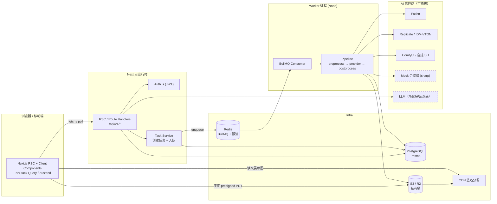
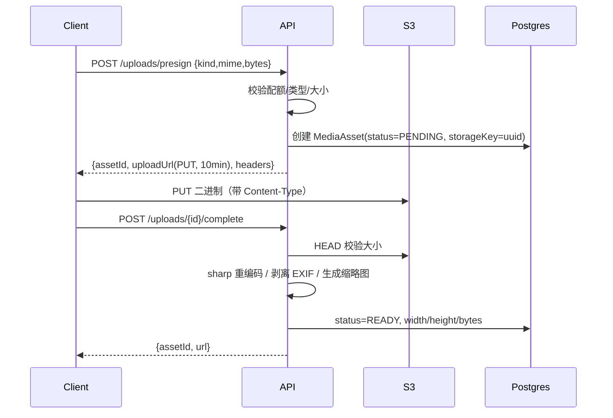
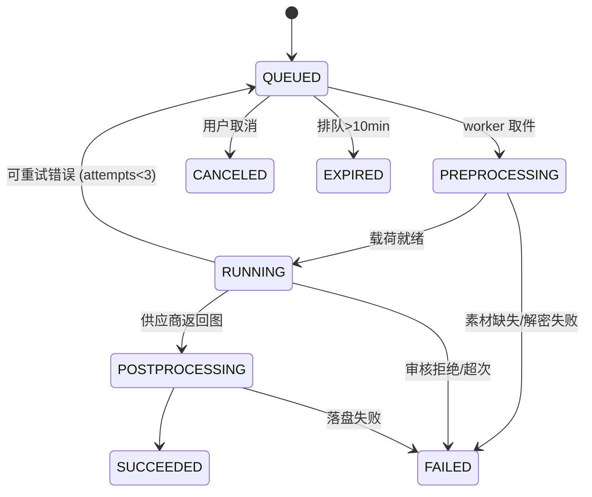
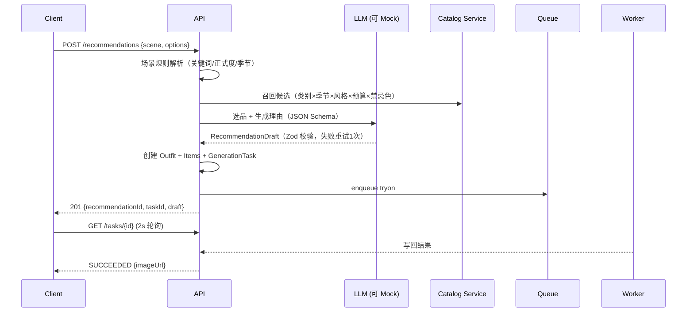

# 技术架构

| 项 | 内容 |
| --- | --- |
| 版本 | v1.0 |
| 关联 | [PRD](01-PRD.md) · [数据模型](03-database.md) · [API](04-api.md) · [目录](06-directory.md) |

---

## 1. 架构总览

**形态**：一个 Next.js 全栈应用（Web + API Routes）+ 一个可独立伸缩的 Worker 进程（生成任务消费者）。两者共享 `src/server` 领域代码，避免"前端一套 DTO、后端一套 DTO"的漂移。



**为什么不是纯 serverless**：真实虚拟试衣单张 20–60s，Serverless 函数时长与并发成本不可控；Worker 可常驻、可水平扩容、可设置并发上限保护供应商配额。Vercel 部署时 Worker 单独跑在 Render/Fly/Railway，API 仍可留在 Vercel。

---

## 2. 技术选型

| 层 | 选型 | 理由 / 备选 |
| --- | --- | --- |
| 框架 | Next.js 15（App Router, RSC） | 同仓前后端、流式渲染、部署面广；备选：NestJS + 独立前端（更重，v1 不需要） |
| 语言 | TypeScript strict | 端到端类型，Zod 共享校验 |
| UI | Tailwind CSS 4 + shadcn/ui + Radix | 可控、可访问、无锁定；动画用 Framer Motion |
| 状态 | TanStack Query v5（服务端状态）+ Zustand（编辑器） | 轮询/缓存/失效内建；编辑器需要细粒度本地状态与 undo |
| 表单 | react-hook-form + zodResolver | 同构校验 |
| 数据库 | PostgreSQL 16 + Prisma 6 | 关系清晰、数组/JSONB 支持筛选；Prisma 迁移可审计 |
| 鉴权 | Auth.js v5（next-auth），JWT session | 内置 Credentials + OAuth 扩展；DB 只存 Account |
| 队列 | BullMQ（Redis 7） | 延迟重试、并发控制、任务去重；本地可切 inline |
| 对象存储 | S3 兼容（AWS S3 / Cloudflare R2 / MinIO） | 统一 S3 SDK；本地用 MinIO 或 fs 驱动 |
| 图片处理 | sharp | 裁切/缩放/合成/去 EXIF/WebP，Worker 与 API 共用 |
| 图片编辑 | react-easy-crop + @dnd-kit + 自研画布 | 轻、移动端手势好；备选 Konva（更重） |
| 校验 | Zod | API 入参 + AI 输出双重校验 |
| 日志/观测 | pino + OpenTelemetry（可选 Sentry） | 结构化日志带 requestId/taskId |
| 测试 | Vitest（单元/服务）+ Playwright（E2E） | 覆盖生成状态机与关键链路 |
| 部署 | Docker Compose（本地/自建）/ Vercel + Neon + Upstash + R2 | 两套路径都保留 |

---

## 3. 模块划分

```
┌───────────────────────────── Presentation ─────────────────────────────┐
│ app/(marketing)  app/(app)/studio  app/(app)/recommend  app/(app)/feed │
│ app/(app)/me     app/(admin)       components/ui (shadcn)              │
└───────────────────────────────┬───────────────────────────────────────┘
                                │ fetch / server actions
┌───────────────────────────────▼───────────────────────────────────────┐
│ features/*  —— 前端功能域：components / hooks / api client / schema    │
└───────────────────────────────┬───────────────────────────────────────┘
                                │ /api/v1
┌───────────────────────────────▼───────────────────────────────────────┐
│ server/http  —— 路由处理、鉴权、Zod 校验、错误映射、限流、幂等          │
├───────────────────────────────────────────────────────────────────────┤
│ server/services —— outfit / garment / generation / recommendation /    │
│                   post / moderation / media / quota / notification     │
├───────────────────────────────────────────────────────────────────────┤
│ server/ai (providers)  server/queue  server/storage  server/security   │
├───────────────────────────────────────────────────────────────────────┤
│ Prisma → PostgreSQL      S3 SDK      BullMQ → Redis      sharp         │
└───────────────────────────────────────────────────────────────────────┘
```

**边界规则**

- Route Handler 不写业务逻辑，只做「解析 → 鉴权 → 调 service → 映射响应」。
- Service 不依赖 `next/*`，可在 Worker / 脚本 / 测试中直接调用。
- 前端不直接 import `server/*`（ESLint `no-restricted-imports` 强制）；只能通过 `features/*/api.ts`。
- AI Provider 只依赖 `Buffer`/`URL`，不依赖 DB，便于单测与替换。

---

## 4. 关键流程

### 4.1 直传上传



> 敏感图（FACE/FULL_BODY）在 complete 阶段由服务端拉取原图、加密后写入 `*.enc`，并删除明文对象；后续只能通过鉴权代理读取。

### 4.2 生成任务状态机



| 阶段 | 动作 | 失败处理 |
| --- | --- | --- |
| PREPROCESSING | 读取/解密底图、解析单品抠图、构建 provider 载荷、生成临时签名 URL | 素材缺失 → 终态失败（不可重试） |
| RUNNING | 调供应商（超时 90s，AbortController）；记录 providerJobId | 5xx/超时 → 指数退避重试；4xx/审核 → 终态 |
| POSTPROCESSING | 下载结果 → 校验是图片 → sharp 重编码 → 上传 → 建 `MediaAsset` → 关联 Outfit | 重试 2 次后失败 |
| 成功 | 更新 task.output、outfit.resultImageId、写通知、埋点 | — |

**重试与降级**

```
attempt 1: fashn        ──fail(5xx)──▶ backoff 2s
attempt 2: fashn        ──fail(5xx)──▶ backoff 8s
attempt 3: replicate    ──fail(5xx)──▶ 降级
fallback : mock-composite (sharp 拼贴)  → SUCCEEDED(output.degraded=true)
```

- 供应商熔断：连续 10 次失败 → 打开 5 分钟，期间直接走备用/降级。
- 审核拒绝（`SAFETY`）不重试、不降级，提示用户更换素材。
- 幂等：`GenerationTask(userId, idempotencyKey)` 唯一；Webhook 以 `providerJobId` 定位，状态只允许前进（终态不可覆盖）。

### 4.3 AI 推荐（文字先出、图后出）



- LLM 不可用 → `RuleBasedStylist`（规则模板）输出，保证功能不挂。
- 输出强约束：`RecommendationDraftSchema`（见 [API 文档](04-api.md#7-ai-推荐)），单品必须来自召回集合（`garmentId` 白名单校验），防止幻觉。

---

## 5. ImageGenerationService 抽象

```ts
// src/server/ai/types.ts
export type ProviderId = 'MOCK' | 'FASHN' | 'REPLICATE' | 'COMFYUI';

export interface TryOnInput {
  bodyImage: Buffer;                    // 已解码、已转正
  faceImage?: Buffer;                   // 可选，仅用于保持面部
  garments: Array<{
    slot: GarmentSlot;
    image: Buffer;                      // 已抠图 PNG
    transform?: { x: number; y: number; scale: number; rotation: number };
  }>;
  options: {
    preserveFace: boolean;
    background: 'original' | 'plain' | 'scene';
    aspectRatio: '3:4' | '1:1';
    seed?: number;
    promptHint?: string;                // 场景/风格，仅部分供应商支持
  };
}

export interface ProviderResult {
  image: Buffer;
  providerJobId?: string;
  costCents?: number;
  meta?: Record<string, unknown>;
}

export interface ImageGenerationProvider {
  readonly id: ProviderId;
  isConfigured(): boolean;
  /** 同步供应商（Mock / 自建 ComfyUI） */
  generate?(input: TryOnInput, signal: AbortSignal): Promise<ProviderResult>;
  /** 异步供应商（Fashn / Replicate），与 webhook 或 poll 配合 */
  submit?(input: TryOnInput): Promise<{ jobId: string; pollAfterMs?: number }>;
  poll?(jobId: string): Promise<{ status: 'pending' | 'succeeded' | 'failed'; result?: ProviderResult; error?: string }>;
}
```

**路由策略**：`provider = env.AI_PROVIDER ?? 'MOCK'`，配置了多供应商时按 `AI_PROVIDER_CHAIN=fashn,replicate,mock` 顺序尝试；每家的请求/响应映射只存在于 `src/server/ai/providers/*.ts`，上层只认 `TryOnInput`。

**Mock Provider**（零 Key 可跑）：sharp 读取底图尺寸 → 按 `transform` 把每件单品缩放到相对人体的合理比例（上装宽度 0.42×画布、下装 0.38×、鞋 0.18×…）→ 依 `slot` 顺序合成 → 轻微阴影与整体调色 → 输出 WebP。效果是"拼贴预览"，明确标注，不冒充真实试衣。

---

## 6. 队列设计

| 项 | 设计 |
| --- | --- |
| 驱动 | `QUEUE_DRIVER=bullmq`（默认生产）/ `inline`（无 Redis 本地开发）/ `disabled`（测试） |
| 队列 | `tryon`（并发 2/实例）、`cutout`（并发 4）、`maintenance`（清理/导出/热度重算） |
| 任务名 | `tryon.generate`、`garment.cutout`、`outfit.compose`、`privacy.export`、`post.hot-score` |
| 重试 | BullMQ attempts=3，backoff exponential 2s；`jobId=taskId` 天然去重 |
| 限流 | 全局 60 次/分钟生成；单用户同时 2 个；供应商维度并发上限 |
| 死信 | 3 次失败进 `failed` 集合，后台可一键重放 |
| 优雅退出 | 捕获 SIGTERM，等待在途任务 ≤30s 再退出 |
| inline 模式 | `void runTask(taskId)` 在 API 进程内异步执行；仅供本地/演示，Vercel 上必须用外部 Worker 或 Webhook |

---

## 7. 存储与 CDN

**Bucket 布局**

```
private/
  users/{userId}/face/{assetId}.enc          # AES-GCM 密文
  users/{userId}/body/{assetId}.enc
  users/{userId}/garment/{assetId}.png
catalog/{garmentId}/main.webp
catalog/{garmentId}/cutout.png
public/
  results/{taskId}/{assetId}.webp
  posts/{postId}/{assetId}.webp
  thumbs/{assetId}.webp
```

- 私有桶禁止公共读；公开图走 CDN + 长缓存（`immutable`），key 含内容 hash 便于失效。
- 读图统一 `GET /api/v1/media/:id/url?purpose=display|download|face-preview` → 返回 5 分钟签名 URL；`face-preview` 仅 owner + 60s。
- 本地开发：`STORAGE_DRIVER=local`，写入 `.data/uploads`，由 `/api/dev/blob/[...key]` 提供（仅 NODE_ENV=development）。
- 上传校验：magic bytes（jpg/png/webp/heic）、`sharp` 解码成功、像素上限 40MP、剥离 EXIF/GPS。

---

## 8. 安全设计

| 面 | 措施 |
| --- | --- |
| 认证 | Auth.js JWT；Cookie HttpOnly/Secure/SameSite=Lax；30 天滑动过期；登录限流 5 次/15min |
| 授权 | 每个查询带 `ownerId`/`authorId`；`requireUser()` / `requireAdmin()` 守卫；资源不存在与无权限统一 404 |
| 输入 | Zod 全量校验；富文本仅存纯文本；URL 白名单协议；文件 magic bytes |
| 人脸加密 | 信封加密：`DEK=random(32)`，`AES-256-GCM(DEK, plaintext)`，`KEK` 加密 DEK 后存 `metadata.dek`；KEK 来自 KMS/`MEDIA_KEK`，不落库 |
| 越权 | 签名 URL 短 TTL；对象 key 为 UUID；管理端操作写审计 |
| 注入/XSS | Prisma 参数化；React 默认转义；禁止 `dangerouslySetInnerHTML`（除经 sanitize 的政策页） |
| CSRF | SameSite=Lax + Auth.js 内建；写接口校验 Origin |
| 速率 | Redis 滑窗：登录 5/15min、生成 10/h、发帖 10/day、评论 30/h、举报 20/day |
| 密钥 | 仅服务端环境变量；`/api/v1/config` 只暴露 `{provider, mockMode, features}`；构建期扫描 `NEXT_PUBLIC_*` 禁止出现 key |
| 审计 | `AuditLog`：登录、授权变更、删除、下架、封禁、管理端读写 |

**隐私生命周期**

```
上传 → 同意记录 → 加密存储(180d) → 使用(仅任务期间解密到内存) → 撤回/删除 → 对象删除 + key 置空 + 审计
```

- 默认保留期：人脸/全身原图 180 天；结果图随方案（用户删除即删）。
- 定时任务每日清理：过期临时对象、`PENDING` 超 24h 的上传、软删 30 天前的账号数据。

---

## 9. 部署拓扑

### 方案 A：托管（推荐快速上线）

| 组件 | 服务 |
| --- | --- |
| Web/API | Vercel（Node runtime） |
| DB | Neon / Supabase Postgres |
| Redis | Upstash Redis |
| 存储/CDN | Cloudflare R2 + 自定义域 |
| Worker | Render / Fly.io（Docker，常驻） |
| 定时 | Vercel Cron → `/api/cron/*`（带 CRON_SECRET） |

> Serverless 下 `QUEUE_DRIVER=bullmq` + 外部 Worker；若暂时不部署 Worker，可对真实供应商用 Webhook 模式（`callbackUrl` 指向 Vercel）。

### 方案 B：单机 Docker Compose（自建/演示）

```
web (next start :3000) ── worker (node worker.js)
        │                      │
        ├── postgres:16        ├── redis:7
        └── minio:9000 ────────┘
```

### 环境变量（完整清单见 [06-directory.md](06-directory.md#5-环境变量)）

```dotenv
DATABASE_URL=postgresql://...
NEXTAUTH_SECRET=...
NEXTAUTH_URL=http://localhost:3000
QUEUE_DRIVER=inline            # inline | bullmq
REDIS_URL=redis://localhost:6379
STORAGE_DRIVER=local           # local | s3
S3_ENDPOINT= S3_BUCKET= S3_ACCESS_KEY_ID= S3_SECRET_ACCESS_KEY=
MEDIA_KEK=base64:...           # 32 bytes
AI_PROVIDER=MOCK               # MOCK | FASHN | REPLICATE | COMFYUI
AI_PROVIDER_CHAIN=mock
FASHN_API_KEY= REPLICATE_API_TOKEN=
LLM_PROVIDER=mock              # mock | openai | deepseek
```

**启动自检**：`/api/health` 返回 `{db, storage, queue, provider}` 各项 `ok/degraded`；缺 Key 时 `provider=mock` 并给出 `warnings`。

---

## 10. 可观测性与成本

- **日志**：pino JSON，字段 `requestId, userId, taskId, provider, latencyMs, code`；敏感字段脱敏（email hash、URL 去签）。
- **指标**：`generation_total{status,provider}`、`generation_duration_seconds`、`queue_depth`、`upload_bytes`、`llm_tokens`。
- **追踪**：OpenTelemetry span：`api.request → task.create → queue.publish → worker.consume → provider.call → storage.put`。
- **告警**：生成失败率 >5%（5min）、队列积压 >100、供应商 P95 >90s、DB 连接池 >80%。
- **成本控制**：按用户日额度、分辨率档（512/1024/1536）、结果缓存（同底图+同单品+同参数 24h 内复用）、供应商比价、失败不计费。

---

## 11. 架构决策记录（ADR）

| ID | 决策 | 备选 | 理由 |
| --- | --- | --- | --- |
| ADR-001 | Next.js 单体 + 独立 Worker | NestJS 独立后端 | v1 团队小、领域服务可复用；NestJS 的 DI/模块在 Next 中用目录边界替代；后续可平滑拆出 |
| ADR-002 | Auth.js JWT 会话 | 自建 JWT / DB session | 少一张表、少一次查询；OAuth 扩展成本低；撤销靠短 TTL + 版本号 |
| ADR-003 | 归一化坐标 + 服务端合成 | 前端 canvas 导出 | 导出质量/分辨率可控、可复用同一套 transform 做真实试衣提示、避免跨端渲染差异 |
| ADR-004 | 队列双驱动（inline/BullMQ） | 只支持 BullMQ | 零依赖本地跑通是硬需求；接口一致，切生产只改环境变量 |
| ADR-005 | Provider 适配器 + 降级链 | 直连单一 SDK | 供应商质量/价格/稳定性波动大；避免锁定 |
| ADR-006 | 私有桶 + 应用层加密 | 公有桶 + 随机文件名 | 人脸属敏感生物识别信息，必须可证明的访问控制 |
| ADR-007 | Prisma + Postgres | Drizzle / MongoDB | 关系与约束强；Prisma 迁移与类型生成成熟；JSONB 存 provider 元数据 |
| ADR-008 | 轮询优先、SSE 增强 | WebSocket | 轮询实现简单、Serverless 友好；SSE 作为 P1 增强，WebSocket 过重 |
| ADR-009 | Mock-first 开发 | 先接真 API | 无 Key 可演示、可测试、CI 稳定；真实供应商只替换 adapter |

---

## 12. 扩展性预案

- **生成吞吐**：Worker 无状态，按队列深度 HPA；供应商配额用 Redis 令牌桶全局协调。
- **读多写少**：衣橱/信息流加 Redis 缓存（key 含筛选 hash），发布/编辑时失效。
- **多区域**：对象存储与 DB 按区域部署；人脸数据不出境（合规）。
- **拆服务时机**：生成 QPS >50 或团队 >8 人时，把 `generation + ai + queue` 拆为独立服务，API 通过内部 RPC 调用；当前目录已按此边界组织。
