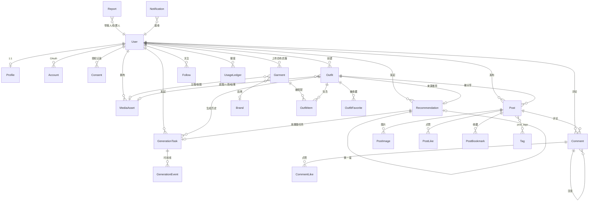

# 数据模型

| 项 | 内容 |
| --- | --- |
| 数据库 | PostgreSQL 16 |
| ORM | Prisma 6（`prisma/schema.prisma`） |
| 表数 | 30（含 Auth.js 3 张） |
| 约定 | 表名 snake_case（`@@map`），主键 `cuid()`，时间 UTC，金额用「分」存 `Int` |

---

## 1. ERD（核心实体）



---

## 2. 枚举字典

| 枚举 | 取值 | 用途 |
| --- | --- | --- |
| `Role` | USER, ADMIN | 权限 |
| `UserStatus` | ACTIVE, SUSPENDED, DELETED | 账号状态 |
| `Gender` | FEMALE, MALE, NON_BINARY, PREFER_NOT_SAY | 用户/推荐 |
| `GarmentGender` | WOMEN, MEN, UNISEX | 商品适用 |
| `BodyShape` | HOURGLASS, PEAR, APPLE, RECTANGLE, INVERTED_TRIANGLE, UNKNOWN | 体型（可选） |
| `ConsentType` | TERMS, PRIVACY, FACE_IMAGE_PROCESSING, MARKETING | 授权类型 |
| `EncryptionMode` | NONE, AES_256_GCM | 媒体加密 |
| `MediaKind` | FACE, FULL_BODY, GARMENT_RAW, GARMENT_CUTOUT, RESULT, POST_IMAGE, EXPORT | 媒体用途 |
| `MediaStatus` | PENDING, READY, FAILED, DELETED | 媒体状态 |
| `MediaVisibility` | PRIVATE, UNLISTED, PUBLIC | 可见性 |
| `ModerationStatus` | PENDING, APPROVED, REJECTED, NEEDS_REVIEW | 审核状态 |
| `ModerationDecision` | PASS, REVIEW, BLOCK | 审核结论 |
| `ModerationSource` | HEURISTIC, AI, HUMAN | 审核来源 |
| `GarmentCategory` | TOP, BOTTOM, DRESS, OUTERWEAR, SHOES, BAG, ACCESSORY | 品类 |
| `Slot` | TOP, BOTTOM, DRESS, OUTERWEAR, SHOES, BAG, ACCESSORY | 画布槽位（与品类对齐） |
| `ColorTag` | BLACK, WHITE, GRAY, BEIGE, BROWN, RED, ORANGE, YELLOW, GREEN, BLUE, NAVY, PURPLE, PINK, GOLD, SILVER, MULTI | 颜色 |
| `StyleTag` | MINIMAL, CASUAL, STREET, BUSINESS, SMART_CASUAL, SPORTY, ROMANTIC, VINTAGE, Y2K, KOREAN, FRENCH, OUTDOOR, PREPPY, GOTHIC | 风格 |
| `Season` | SPRING, SUMMER, AUTUMN, WINTER, ALL_SEASON | 季节 |
| `GarmentStatus` | DRAFT, PROCESSING, READY, PUBLISHED, ARCHIVED | 商品状态 |
| `GarmentSource` | PLATFORM, USER_UPLOAD, AI_GENERATED | 来源 |
| `OutfitSource` | FREE_STYLE, AI_RECOMMENDATION | 方案来源 |
| `OutfitVisibility` | PRIVATE, UNLISTED, PUBLIC | 可见性 |
| `OutfitStatus` | DRAFT, SAVED, GENERATING, READY, FAILED | 方案状态 |
| `TaskType` | VIRTUAL_TRYON, BG_REMOVAL, SCENE_RECOMMEND, DATA_EXPORT | 任务类型 |
| `TaskStatus` | QUEUED, PREPROCESSING, RUNNING, POSTPROCESSING, SUCCEEDED, FAILED, CANCELED, EXPIRED | 任务状态 |
| `AIProvider` | MOCK, FASHN, REPLICATE, COMFYUI | 供应商 |
| `TagKind` | STYLE, SCENE, GENERAL | 标签类型 |
| `PostStatus` | DRAFT, PENDING_REVIEW, PUBLISHED, REJECTED, REMOVED, DELETED | 帖子状态 |
| `CommentStatus` | PUBLISHED, HIDDEN, DELETED | 评论状态 |
| `ReportTargetType` | POST, COMMENT, USER | 举报对象 |
| `ReportReason` | SEXUAL, ILLEGAL, VIOLENCE, COPYRIGHT, SPAM, HARASSMENT, OTHER | 举报原因 |
| `ReportStatus` | OPEN, REVIEWING, RESOLVED, REJECTED | 处理状态 |
| `NotificationType` | GENERATION_DONE, GENERATION_FAILED, LIKE, COMMENT, FOLLOW, MENTION, SYSTEM, MODERATION | 通知 |
| `UsageKind` | TRYON, CUTOUT, REROLL, EXPORT | 额度类型 |

---

## 3. 表字典

### 3.1 身份与账户

| 表 | 关键字段 | 说明 | 索引 |
| --- | --- | --- | --- |
| `users` | `id, email, password_hash, handle, role, status, email_verified, deleted_at` | 账号主体；`handle` 用于 `/u/[handle]`，注册时生成 `u_xxxxxxxx` | `email` uniq, `handle` uniq, `(status, created_at)` |
| `accounts` | `user_id, provider, provider_account_id, access_token, refresh_token` | Auth.js OAuth 账户；v1 仅预留 | `(provider, provider_account_id)` uniq |
| `verification_tokens` | `identifier, token, expires` | 邮箱验证/重置密码 | `token` uniq, `(identifier, token)` uniq |
| `profiles` | `user_id, gender, height_cm, weight_kg, body_shape, city, style_prefs[], avoided_colors[], budget_min/max, is_public` | 推荐个性化输入；`style_prefs` 为枚举数组 | `user_id` uniq |

### 3.2 隐私与媒体

| 表 | 关键字段 | 说明 | 索引 |
| --- | --- | --- | --- |
| `consents` | `user_id, type, policy_version, granted, granted_at, revoked_at, ip_hash, user_agent, media_asset_id` | 每次授权一条；撤回写 `revoked_at`；人脸授权绑定具体媒体 | `(user_id, type)`, `(media_asset_id)` |
| `media_assets` | `owner_id, kind, status, visibility, storage_key, mime_type, bytes, width, height, checksum, encryption, is_sensitive, moderation_status, expires_at, deleted_at, metadata` | 所有二进制资产登记表；`storage_key` 唯一；敏感图 `encryption=AES_256_GCM` + `visibility=PRIVATE` | `(owner_id, kind)`, `(status, created_at)`, `storage_key` uniq |

> `metadata` 存 `{ dekWrapped, iv, tag, thumbKey, exifStripped, originalName? }`，DEK 不落明文库。

### 3.3 商品与衣橱

| 表 | 关键字段 | 说明 | 索引 |
| --- | --- | --- | --- |
| `brands` | `name, slug, logo_key, site_url` | 品牌字典 | `slug` uniq |
| `garments` | `slug, name, category, sub_category, gender, colors[], primary_color_hex, styles[], seasons[], materials[], fit, brand_id, price_cents, currency, purchase_url, image_id, cutout_id, attributes(jsonb), source, owner_id, status, popularity` | 结构化单品；平台库 + 用户自有（`owner_id` 非空且 `source=USER_UPLOAD`）共用一张表，便于推荐复用 | `(category, status)`, `(status, popularity desc)`, `(owner_id)`, GIN(`colors`,`styles`,`seasons`) |
| `outfits` | `owner_id, title, source, status, visibility, base_photo_id, face_photo_id, result_image_id, cover_image_id, note, favorite_count, deleted_at` | 一套方案；AI 推荐也落为 Outfit 以复用编辑器与分享 | `(owner_id, status)`, `(visibility, created_at)` |
| `outfit_items` | `outfit_id, garment_id, slot, z_index, is_primary, transform(jsonb), reason` | 画布单品；`transform={x,y,scale,rotation}` 归一化 0–1；`reason` 存 AI 推荐理由 | `(outfit_id, slot)`, `(garment_id)` |
| `outfit_drafts` | `user_id, user_photo_id, face_photo_id, layers(jsonb), status, result_image_id, outfit_id` | 编辑态草稿：未生成/未保存时的照片 + 图层快照，`status` 为 `EDITING/GENERATED/SAVED/DISCARDED` | `(user_id, status)`, `outfit_id` uniq |

**业务约束（应用层 + DB check）**

- 一套方案内 `DRESS` 不能与 `TOP`/`BOTTOM` 共存。
- 单套 `outfit_items` ≤ 8。
- 用户自有单品仅 owner 可见；平台单品 `status=PUBLISHED` 才进入衣橱。

### 3.4 生成任务

| 表 | 关键字段 | 说明 | 索引 |
| --- | --- | --- | --- |
| `generation_tasks` | `user_id, type, status, provider, provider_job_id, idempotency_key, progress, attempts, max_attempts, input(jsonb), output(jsonb), error_code, error_message, cost_cents, outfit_id, started_at, finished_at, expires_at` | 异步任务唯一事实源；`output={imageId,degraded,latencyMs,provider}` | `(user_id, idempotency_key)` uniq, `(status, created_at)`, `(provider_job_id)` |
| `generation_events` | `task_id, status, message, payload, created_at` | 状态时间线，排障与用户可见进度 | `(task_id, created_at)` |

### 3.5 AI 推荐

| 表 | 关键字段 | 说明 | 索引 |
| --- | --- | --- | --- |
| `recommendations` | `user_id, scene_text, parsed(jsonb), inputs(jsonb), style_title, rationale, tips[], avoid_tips[], outfit_id, task_id, parent_id, provider, model, latency_ms, status, items_json, result_image_id, is_favorite, saved_at` | 一次推荐结果；`parsed={occasion,formality,season,weather,keywords}`；`parent_id` 记录"换一套"链；`items_json` 为推荐快照（含 AI 建议项）；`status` 为 `PENDING/READY/DEGRADED/FAILED` | `(user_id, created_at)`, `(user_id, is_favorite)`, `outfit_id` uniq, `task_id` uniq |

### 3.6 社区

| 表 | 关键字段 | 说明 | 索引 |
| --- | --- | --- | --- |
| `posts` | `author_id, title, body, cover_image_id, outfit_id, recommendation_id, status, moderation_status, like_count, comment_count, bookmark_count, view_count, hot_score, published_at, deleted_at` | 帖子；计数冗余便于排序；`recommendation_id` 关联 AI 推荐 | `(status, published_at desc)`, `(status, hot_score desc)`, `(author_id, created_at)`, `(recommendation_id)` |
| `post_images` | `post_id, media_id, position` | 1–9 张 | `(post_id, position)` uniq |
| `tags` | `slug, name, kind, usage_count` | 风格/场景/通用标签 | `slug` uniq, `(kind, usage_count desc)` |
| `post_tags` | `post_id, tag_id` | 多对多 | `(post_id, tag_id)` uniq |
| `comments` | `post_id, author_id, parent_id, body, status, like_count, deleted_at` | 一级评论 + 一级回复 | `(post_id, created_at)`, `(parent_id)` |
| `post_likes` | `post_id, user_id` | 点赞 | `(post_id, user_id)` uniq, `(user_id)` |
| `comment_likes` | `comment_id, user_id` | 评论点赞 | `(comment_id, user_id)` uniq |
| `post_bookmarks` | `post_id, user_id` | 收藏帖子 | `(post_id, user_id)` uniq, `(user_id, created_at)` |
| `outfit_favorites` | `outfit_id, user_id` | 收藏方案 | `(outfit_id, user_id)` uniq, `(user_id)` |
| `follows` | `follower_id, following_id` | 关注 | `(follower_id, following_id)` uniq, `(following_id)` |

### 3.7 治理与运营

| 表 | 关键字段 | 说明 | 索引 |
| --- | --- | --- | --- |
| `reports` | `reporter_id, target_type, target_id, reason, detail, status, handled_by_id, resolution, created_at` | 举报（多态 target，无 FK） | `(status, created_at)`, `(target_type, target_id)` |
| `moderation_records` | `target_type, target_id, source, labels[], score, decision, reviewer_id, note` | 每次机审/人审留痕 | `(target_type, target_id)` |
| `sensitive_terms` | `term, category, action, enabled` | 本地词库，`action=BLOCK/REVIEW` | `term` uniq |
| `notifications` | `recipient_id, actor_id, type, entity_type, entity_id, payload, read_at` | 站内通知 | `(recipient_id, read_at, created_at)` |
| `audit_logs` | `actor_id, action, target_type, target_id, ip_hash, user_agent, meta` | 管理端与敏感操作审计，只增不改 | `(actor_id, created_at)`, `(action, created_at)` |
| `usage_ledger` | `user_id, day, kind, count, cost_cents` | 每日额度与成本账本 | `(user_id, day, kind)` uniq |

---

## 4. 索引与查询策略

1. **数组筛选**：`colors/styles/seasons` 用 `String[]`/枚举数组 + GIN 索引（Prisma 不支持声明，迁移中手写）：
   ```sql
   CREATE INDEX garments_colors_gin ON garments USING GIN (colors);
   CREATE INDEX garments_styles_gin ON garments USING GIN (styles);
   CREATE INDEX garments_seasons_gin ON garments USING GIN (seasons);
   ```
   查询用 `colors && ARRAY['BLACK','WHITE']::"ColorTag"[]`（重叠即命中）。
2. **信息流**：`(status, hot_score DESC)` 覆盖热门；`(status, published_at DESC)` 覆盖最新；关注流先取 `follows` 的 `following_id` 再 `IN` 查询（或物化视图，P2）。
3. **软删**：查询统一 `deleted_at IS NULL`；为高频表建部分索引：`CREATE INDEX ... WHERE deleted_at IS NULL`。
4. **计数**：`like_count/comment_count` 与明细表同事务 `increment`，每日对账任务修正漂移。
5. **JSONB**：`attributes`（颜色 hex、版型、洗涤）、`parsed`、`transform` 用 JSONB；仅 `attributes->>'fit'` 之类低频查询建表达式索引（按需）。

---

## 5. 数据生命周期

| 数据 | 保留 | 清理方式 |
| --- | --- | --- |
| 人脸/全身原图 | 180 天（可配置） | 定时任务删除对象 + `media_assets.status=DELETED`，key 置 `deleted/{id}` |
| 生成结果图 | 随方案，方案删除即删 | 级联 |
| 任务记录 | 90 天 | 归档到冷表后删除（P1） |
| 通知 | 90 天 | 定时删除已读 |
| 审计日志 | 1 年 | 归档 |
| 注销账号 | 软删 30 天 | 到期物理删除所有关联（含对象存储前缀 `users/{id}/`） |
| 上传未完成 | 24h | 定时清理 `PENDING` |

**删除传播**：删除 `User` → 级联删除 Profile/Consent/MediaAsset/Outfit/Post…；对象存储按前缀异步清理；`AuditLog` 保留（`actor_id` 置空）以满足审计要求。

---

## 6. 种子数据（Mock）

`prisma/seed.ts` 生成：

- 1 个管理员 `admin@ootd.local / Admin1234`，1 个演示用户 `demo@ootd.local / Demo1234`（含 Profile）。
- 3 个品牌（COS、Uniqlo、独立设计师）。
- **48 件平台单品**：7 个品类全覆盖；每类 ≥5 件；颜色/风格/季节组合分散，价格 99–2999 元；使用本地生成的纯色/渐变 PNG 占位图（sharp 生成，避免外链失效）。
- 6 套示例方案（3 套公开用于首页展示）。
- 8 篇示例帖子 + 12 个标签 + 若干评论/点赞。
- 敏感词 20 条（演示用，非真实词库）。

> 占位图策略：`prisma/seed-assets/` 下用脚本生成"衣服剪影 + 主色块"的 PNG，保证离线可用、无版权风险。
