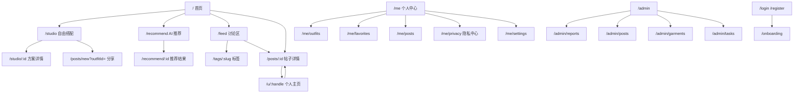

# 页面结构与交互设计

| 项 | 内容 |
| --- | --- |
| 设计关键词 | 试衣间 / 杂志感 / 克制的暖中性色 / 大图优先 |
| 技术 | Next.js App Router（RSC 优先）+ Tailwind + shadcn/ui + Framer Motion |
| 断点 | `sm 640 / md 768 / lg 1024 / xl 1280`，移动优先 |

---

## 1. 站点地图



## 2. 路由清单

| 路由 | 渲染 | 鉴权 | 说明 |
| --- | --- | --- | --- |
| `/` | RSC + 少量客户端 | 公开 | Hero、三种入口、示例搭配、社区精选 |
| `/studio` | 客户端为主 | 登录 | 自由搭配工作台（新建） |
| `/studio/[id]` | 客户端为主 | owner | 编辑/查看已保存方案与结果 |
| `/recommend` | RSC 壳 + 客户端表单 | 登录 | 场景输入 + 条件 + 推荐结果流 |
| `/recommend/[id]` | RSC + 客户端 | owner | 结果详情（可分享只读态） |
| `/feed` | RSC + 无限滚动 | 公开 | 信息流：热门/最新/关注 |
| `/posts/new` | 客户端 | 登录 | 发帖编辑器（支持预填 `outfitId`） |
| `/posts/[id]` | RSC + 客户端交互 | 公开 | 帖子详情 |
| `/tags/[slug]` | RSC | 公开 | 标签聚合 |
| `/u/[handle]` | RSC | 公开 | 个人主页 |
| `/me` | RSC | 登录 | 概览 |
| `/me/outfits` `/me/favorites` `/me/posts` | RSC | 登录 | Tab 子页 |
| `/me/privacy` | 客户端 | 登录 | 授权记录、撤回、删除、导出、注销 |
| `/me/settings` | 客户端 | 登录 | 资料、偏好、密码 |
| `/login` `/register` | 客户端 | 公开 | 邮箱登录/注册 + OAuth 占位 |
| `/onboarding` | 客户端 | 登录 | 3 步引导（可跳过） |
| `/admin/*` | RSC + 表格 | ADMIN | 管理后台 |
| `/legal/privacy` `/legal/terms` `/legal/consent` | RSC 静态 | 公开 | 隐私政策/协议/人脸授权说明 |
| `not-found.tsx` `error.tsx` | — | — | 404 / 错误边界 |

---

## 3. 全局布局

### 桌面

```
┌──────────────────────────────────────────────────────────────────┐
│ OOTD Lab    搭配  AI推荐  讨论区          [搜索]  [铃]  [头像▾] │ 64px  sticky
├──────────────────────────────────────────────────────────────────┤
│                                                                  │
│                          page content                            │
│                                                                  │
└──────────────────────────────────────────────────────────────────┘
```

### 移动

```
┌──────────────────────┐
│ ☰  OOTD Lab     🔔  👤│  56px
├──────────────────────┤
│                      │
│     page content     │
│                      │
├──────────────────────┤
│  ✦搭配  ◇推荐  ◎社区  ☺我 │  底部 Tab 64px + safe-area
└──────────────────────┘
```

- Studio/发帖等沉浸页隐藏底部 Tab，改为顶部「返回 + 标题 + 主操作」。
- 全局 Toast（sonner）、命令式确认弹层、图片灯箱。

---

## 4. 关键页面

### 4.1 首页 `/`

```
┌────────────────────────────────────────────────────────────┐
│  Hero：一张大图（示例生成结果）+                                    │
│  「先看效果，再决定穿什么」                                      │
│  [ 开始搭配 ]  [ 描述场景，让 AI 推荐 → ]                        │
├────────────────────────────────────────────────────────────┤
│  三种玩法  ① 上传照片试穿  ② 说场景出方案  ③ 晒搭配聊经验          │
├────────────────────────────────────────────────────────────┤
│  今日精选搭配（3 张竖图卡片，hover 显示单品清单）                    │
├────────────────────────────────────────────────────────────┤
│  社区热门（4 张方图 + 标题 + 作者）                               │
├────────────────────────────────────────────────────────────┤
│  Footer：隐私 / 协议 / 人脸授权说明 / GitHub                       │
└────────────────────────────────────────────────────────────┘
```

- 未登录可浏览；点击任意 CTA → `/login?next=/studio`。
- Hero 图使用本地生成的示例资产，避免外链依赖。

### 4.2 自由搭配 `/studio`（核心）

**桌面三栏**

```
┌──────────────┬────────────────────────────────┬──────────────┐
│ 衣橱 328px    │            画布                 │ 搭配清单 320px │
│              │                                │              │
│ [搜索______]  │   ┌──────────────────┐         │ 底图 ▣ 更换    │
│ 类别 ▾        │   │                  │         │ 人脸 ▣ 加密    │
│ 颜色 ●●●●     │   │   用户全身照      │         │ ──────────    │
│ 风格 #        │   │  + 单品图层       │         │ 连衣裙  ✕      │
│ 季节 ☀        │   │                  │         │ 鞋      ✕      │
│ ──────────    │   └──────────────────┘         │ ──────────    │
│ ┌────┐┌────┐  │   [撤销][重做]  缩放 100%       │ + 上传我的衣服  │
│ │卡片││卡片│  │   [ ✨ 生成穿搭效果 ]            │ 共 3 件 ¥...   │
│ └────┘└────┘  │                                │              │
│  无限滚动      │                                │              │
└──────────────┴────────────────────────────────┴──────────────┘
```

**移动端**：三段式 Tab「衣橱 / 画布 / 清单」；画布占满视口宽度，底部固定「生成」大按钮；筛选为底部抽屉；上传入口在衣橱顶部。

**状态**

| 状态 | 表现 |
| --- | --- |
| 无底图 | 画布区展示上传引导（虚线框 + 示例图 + 隐私说明） |
| 上传中 | 进度条 + 「正在处理照片」；禁止关闭（可取消） |
| 衣橱加载 | 8 个骨架卡片 |
| 衣橱为空 | 「没有符合条件的单品」+ 清除筛选按钮 |
| 搭配为空 | 清单区「从左侧衣橱挑一件吧」 |
| 生成中 | 画布遮罩 + 进度环 + 阶段文案（排队/处理素材/生成中/收尾）；可离开 |
| 生成失败 | 错误卡片：原因 + 「重试」+「使用预览版（拼贴）」 |
| 生成成功 | 切换到结果态：大图 + 单品清单 + 下载/保存/分享 |

**交互细节**

- 单品卡 hover 出现「+」；点击加入主槽位，拖拽可指定位置。
- 画布图层：拖拽移动，角标缩放，`Shift` 等比，双击置顶，右侧图层面板调序。
- 生成按钮在无底图/无单品时 disabled 并展示原因 tooltip。
- 离开页面前若有未保存改动 → `beforeunload` / 路由拦截确认。

### 4.3 推荐 `/recommend`

**Step 1 输入**（单页表单，非强制分步）

```
┌────────────────────────────────────────────────┐
│ 要去哪儿？                                       │
│ ┌────────────────────────────────────────────┐ │
│ │ 明天去海边约会                              │ │
│ └────────────────────────────────────────────┘ │
│ 试试：海边约会 / 互联网面试 / 朋友婚礼 / 秋冬通勤    │
│                                                │
│ 性别 [女▾]  身高 [165] cm  体重 [52] kg         │
│ 风格 [法式][浪漫][极简] +                        │
│ 预算 [≤500][500-1500][1500-3000][不限]          │
│ 城市 [上海]   禁忌色 [黑][红] +                  │
│ ☐ 只要站内可购买                                 │
│                                                │
│              [ 生成我的穿搭 → ]                  │
└────────────────────────────────────────────────┘
```

**Step 2 结果流**（同页替换）

```
┌─────────────────────────────────────────────────────────┐
│ 海风法式：亚麻白裙 + 草编包                    [换一套]   │
│ 海边风大、日照强……（rationale）                            │
│ #海边 #约会 #法式                          [收藏][保存][分享]│
├──────────────────────────┬──────────────────────────────┤
│  效果图（骨架→图）         │  单品清单 4 件                 │
│  ┌────────────────┐      │  ① 亚麻收腰连衣裙 ¥690 COS     │
│  │   生成中 62%    │      │     理由：收腰+及踝，抗风显比例   │
│  └────────────────┘      │  ② 草编托特包 ¥299             │
│  [重新生成图片]           │  ③ 细带凉鞋 ¥459               │
│                          │  ④ 珍珠耳夹 ¥89                │
│                          │  合计 ¥1537（超出预算 ¥737）     │
├──────────────────────────┴──────────────────────────────┤
│ 搭配建议 ✓ / 避雷 ✗                                       │
└─────────────────────────────────────────────────────────┘
```

- 文字结果 <8s 先渲染；图片单独 loading，不阻塞阅读。
- 单品卡点击 → 侧滑 Drawer（图、品牌、材质、季节、购买链接）。
- 预算超支时顶部黄色提示「已超预算 ¥737，可换一套更省的」。
- 移动端：效果图 sticky 顶部，清单下方滚动；操作按钮固定底部。

### 4.4 讨论区 `/feed`

```
┌───────────────────────────────────────────────┐
│ 讨论区                      [ + 发布穿搭 ]      │
│ [推荐] [最新] [关注]      标签：全部 通勤 约会 …  │
├───────────────────────────────────────────────┤
│ ┌──────┐  海边这套真的绝                       │
│ │ 封面 │  @小美 · 2 小时前 · #法式 #海边        │
│ └──────┘  ♡ 42   💬 8   🔖 12   [关联方案]     │
├───────────────────────────────────────────────┤
│ … 双列瀑布流（桌面）/ 单列（移动）               │
└───────────────────────────────────────────────┘
```

- 骨架屏 6 张；空态「还没有内容，来发第一篇」。
- 图片懒加载 + 模糊占位；点赞乐观更新，失败回滚。
- 无限滚动 + 「回到顶部」。

### 4.5 帖子详情 `/posts/[id]`

- 左：图片轮播（支持键盘/手势）；右：标题、作者（+关注）、正文、标签、关联方案卡片、互动栏。
- 移动端：图片在上，内容在下，评论抽屉。
- 评论区：一级列表 + 「回复」展开；楼主/作者可删；被删显示「该评论已删除」占位。
- 举报入口在「⋯」菜单，弹层选择原因 + 补充说明。

### 4.6 发帖 `/posts/new`

- 标题（计数 5/80）、正文（Markdown 禁用，纯文本 + 换行）、图片上传（1–9，可拖拽排序，首图为封面）、标签选择器（热门 + 搜索 + 新建）、关联方案选择器（我的/公开）、可见性。
- 右侧预览卡（桌面上实时预览信息流卡片）。
- 发布中：按钮 loading + 禁止重复提交；审核中状态提示。
- 自动保存草稿到 localStorage（24h）。

### 4.7 个人主页 `/u/[handle]`

- 头部：头像、昵称、handle、简介、关注/粉丝、关注按钮、分享主页。
- Tab：搭配（公开方案）、帖子、收藏（仅本人可见收藏 Tab）。
- 空态区分「本人」与「访客」文案。

### 4.8 我的 `/me` 与隐私中心

```
/me
├─ 概览卡：方案 12 · 获赞 340 · 关注 18 · 粉丝 96
├─ 快捷：继续编辑 / 新建搭配 / 我的收藏
└─ Tabs：搭配 | 收藏 | 帖子 | 设置

/me/privacy
├─ 人脸信息授权
│   ├─ 状态：已授权（2026-11-01，v2026-11-01）
│   ├─ 说明：加密存储、仅用于生成、不用于训练、180 天自动删除
│   └─ [撤回授权并删除人脸数据]  ← 危险操作，二次确认
├─ 我的照片：3 张（缩略图打码）→ 单张删除
├─ 数据导出：[导出我的数据] → 异步，完成后通知
└─ 注销账号：输入邮箱确认 → 30 天冷静期说明
```

- 任何删除操作展示「将删除什么、不可恢复」清单；成功后 toast + 列表移除。
- 撤回授权后，进行中的任务被取消并提示。

### 4.9 管理后台 `/admin`

- 左侧固定导航；右侧内容区。
- 举报队列：表格（对象、原因、举报人数、时间、状态）+ 右侧详情抽屉（内容预览、历史、处理动作）。
- 商品库：表格 + 批量上下架 + CSV 导入（模板下载、错误行报告）。
- 任务监控：成功率卡片 + 失败列表 + 重试。

---

## 5. 设计系统

### 5.1 色彩

| Token | 值 | 用途 |
| --- | --- | --- |
| `--ink` | `#17130F` | 主文字 |
| `--ink-2` | `#4A423A` | 次级文字 |
| `--muted` | `#8C8278` | 辅助/占位 |
| `--paper` | `#FAF8F4` | 页面底色（暖白） |
| `--surface` | `#FFFFFF` | 卡片 |
| `--line` | `#E9E2D8` | 分割线/描边 |
| `--brand` | `#B4552D` | 主色（砖红），CTA/强调 |
| `--brand-soft` | `#F6E7DF` | 主色浅底 |
| `--camel` | `#C8A47E` | 辅助色（驼），标签/装饰 |
| `--success` | `#2F7D5D` | 成功 |
| `--warning` | `#B7791F` | 警告（超预算） |
| `--danger` | `#B3261E` | 危险/删除 |

深色模式：M2 之后支持，使用 CSS 变量切换（`paper → #12100E`）。

### 5.2 字体与排版

| 层级 | 字体 | 字号/行高 | 用途 |
| --- | --- | --- | --- |
| Display | Noto Serif SC / Georgia | 40–56 / 1.15 | 首页 Hero、结果标题 |
| H1 | Serif | 32 / 1.25 | 页面标题 |
| H2 | Sans 600 | 24 / 1.3 | 区块标题 |
| H3 | Sans 600 | 18 / 1.4 | 卡片标题 |
| Body | Inter / Noto Sans SC | 15 / 1.7 | 正文 |
| Small | Sans | 13 / 1.5 | 元信息 |
| Caption | Sans | 12 / 1.4 | 时间、计数 |

> 中英文混排：`font-feature-settings: "palt"`，数字用 `tabular-nums`。

### 5.3 形状与动效

- 圆角：`sm 6 / md 10 / lg 16 / xl 24 / full`；图片卡用 `lg`，按钮 `full`（胶囊）或 `md`（次按钮）。
- 阴影：`0 1px 2px rgba(23,19,15,.06)`；悬浮卡 `0 12px 32px rgba(23,19,15,.10)`。
- 动效：150ms（hover）/ 250ms（面板）/ 400ms（页面转场）；`ease-out`；尊重 `prefers-reduced-motion`。
- 生成进度：环形进度 + 阶段文案轮播（"正在排队 → 正在处理照片 → AI 正在试衣 → 正在收尾"），避免假进度条。

### 5.4 组件清单（shadcn/ui 映射）

| 场景 | 组件 |
| --- | --- |
| 按钮/图标按钮 | `Button`、`Toggle`、`ToggleGroup` |
| 表单 | `Form` + `Input` + `Textarea` + `Select` + `Slider` + `Switch` + `Checkbox` + `RadioGroup` |
| 弹层 | `Dialog`、`Sheet`（移动端筛选/详情）、`Drawer`、`AlertDialog`（危险确认）、`Popover`、`Tooltip` |
| 导航 | `Tabs`、`Breadcrumb`、`NavigationMenu`、`Pagination`（后台） |
| 数据展示 | `Card`、`Badge`、`Avatar`、`Table`、`Skeleton`、`Progress`、`Separator`、`ScrollArea` |
| 反馈 | `sonner` Toast、`Alert`、`EmptyState`（自研） |
| 上传 | `Dropzone`（自研，基于 `react-dropzone`）+ `react-easy-crop` |
| 画布 | `OutfitCanvas`（自研，Pointer Events + dnd-kit） |

### 5.5 响应式规则

| 断点 | 布局变化 |
| --- | --- |
| <768 | 单列；底部 Tab；Studio 三段 Tab；筛选 Sheet；表格转卡片 |
| 768–1023 | 衣橱 2 列；画布居中；清单抽屉 |
| ≥1024 | Studio 三栏；Feed 双列；帖子详情左右分栏 |
| ≥1440 | 内容最大宽 1280，居中；首页大图更高 |

---

## 6. 空态 / 加载 / 错误 / 边界

| 场景 | 设计 |
| --- | --- |
| 图片加载失败 | 灰底 + 破图图标 + 「重试」，不阻塞布局 |
| 网络离线 | 顶部条「网络已断开，正在重试」；写操作禁用 |
| 401 | 静默刷新会话；失败跳登录并保留 `next` |
| 403 授权缺失 | 弹层引导去授权，不跳走丢失编辑内容 |
| 429 | Toast 显示重置时间；按钮倒计时禁用 |
| 生成超时 | 卡片显示「可能仍在处理」+ 刷新按钮 + 客服入口 |
| 内容被下架 | 详情页显示「该内容已被移除」+ 申诉入口 |
| 图片审核中 | 卡片角标「审核中」，仅作者可见 |

---

## 7. 无障碍与可用性

- 所有交互元素可 Tab 聚焦，`:focus-visible` 2px 主色描边。
- 图片 `alt` 使用「用户搭配：白色亚麻连衣裙 + 草编包」这类描述。
- 颜色不作为唯一信息载体（颜色筛选同时显示色名）。
- 表单错误 `aria-describedby` 关联；Toast 使用 `role=status`。
- 画布提供键盘微调（方向键移动 1px / Shift 10px），并提供「上移/下移/删除」按钮。
- 视频/动效自动播放关闭；生成动画可暂停。

---

## 8. 页面验收（与 PRD 对应）

- [ ] 首页 3 个入口在移动端首屏可见，未登录点击有登录引导。
- [ ] Studio 三栏在 1280 宽无横向滚动；1024 宽降级为两栏 + 抽屉。
- [ ] 上传 → 授权 → 搭配 → 生成 → 保存 全链路 ≤ 8 次点击。
- [ ] 所有异步区域有骨架/进度/失败重试。
- [ ] 结果页单品清单字段完整（名称/类别/颜色/材质/季节/风格/价格/品牌/链接）。
- [ ] 讨论区首屏 <1s（缓存），空态/错误态完整。
- [ ] 隐私中心可完成「撤回授权并删除人脸数据」并即时反馈。
- [ ] Lighthouse：Performance ≥85（移动）、Accessibility ≥95。
