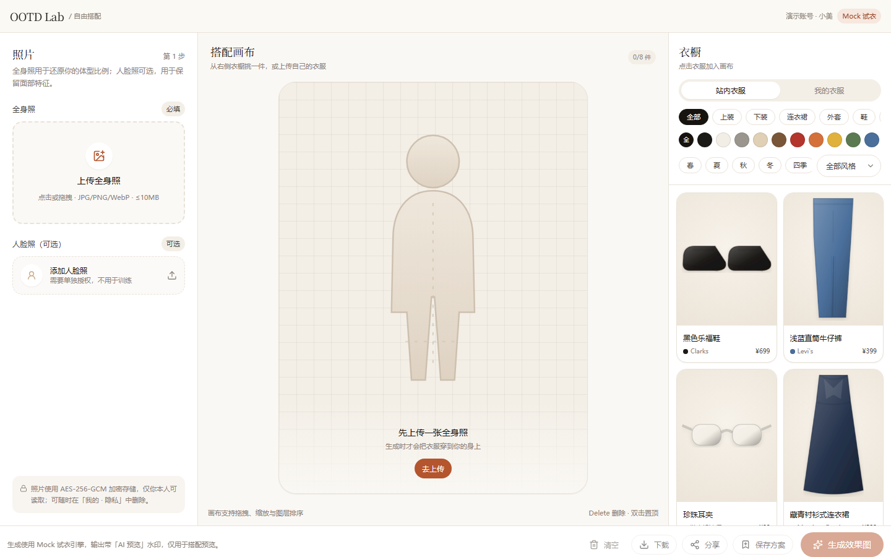
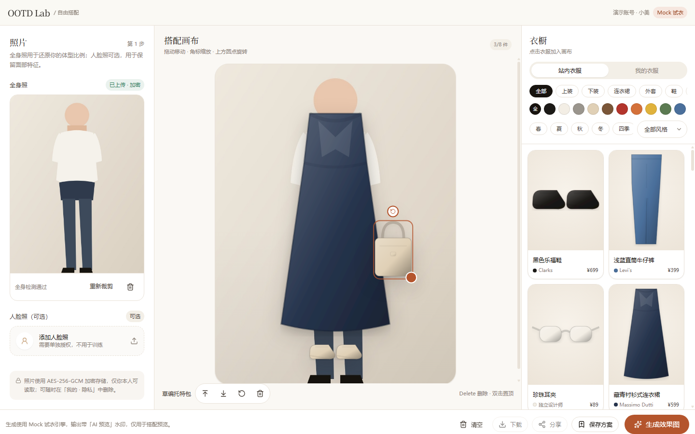
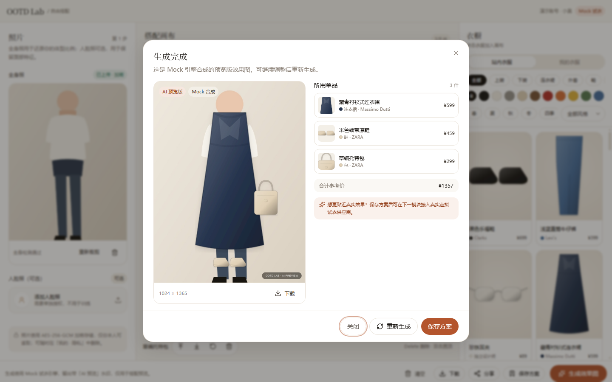
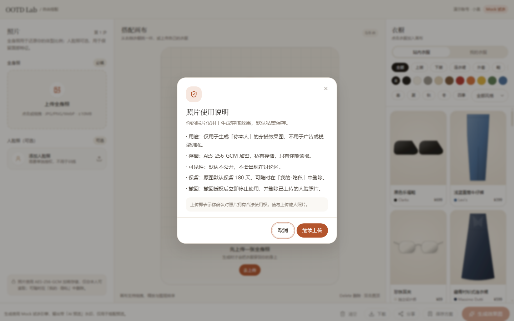
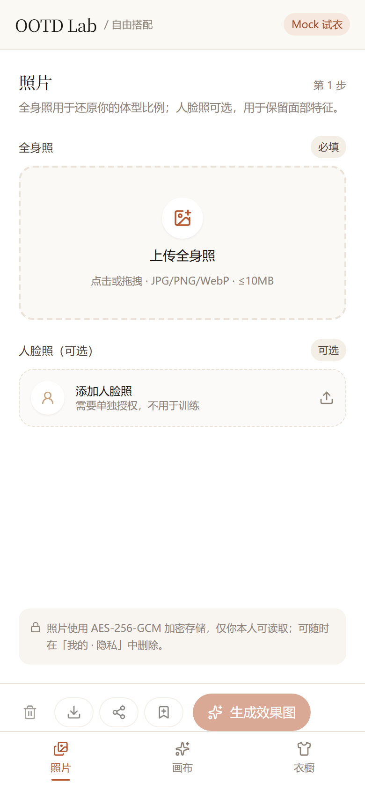

# 模块设计 · 自由搭配（/outfit-studio）

| 项 | 内容 |
| --- | --- |
| 版本 | v1.0 |
| 范围 | 自由搭配页面 + 上传 + 衣橱 + 画布 + 异步试衣 + 保存/分享 |
| 依赖 | M0 数据模型（Garment / Outfit / GenerationTask / MediaAsset / Consent） |
| 不在本模块 | 登录体系（用演示用户）、真实虚拟试衣供应商、讨论区页面 |

---

## 1. 设计决策

| 决策 | 说明 |
| --- | --- |
| **不重复建表** | 你建议的 `ClothingItem` 由既有 `Garment` 承载（字段一一对应）；`UserClothingItem` 即 `Garment(source=USER_UPLOAD, ownerId=当前用户)`；`Outfit` 已存在；新增 `OutfitDraft` 承载"未生成/未保存的编辑态"。 |
| **DTO 扁平化** | 数据库存 `colors[] / styles[] / seasons[]`，API 暴露 `color / style / season` 主值 + 数组，前端筛选更简单，也不丢多标签能力。 |
| **坐标归一化** | 图层存 `x,y ∈ [0,1]`（相对画布宽高）、`scale`（衣宽 / 画布宽）、`rotation`（度）。前端渲染与 sharp 服务端合成共用同一套数值。 |
| **异步生成** | `POST /api/generation/try-on` → `202 {taskId}`；进程内 inline 队列（`setTimeout` + 状态机），后续可无缝换 BullMQ。 |
| **Mock 优先** | 人体检测、抠图、试衣均有本地实现（sharp），无任何第三方 Key 可跑通；接口按真实供应商契约设计。 |
| **隐私** | 人脸/全身照 AES-256-GCM 加密落盘；读取走鉴权代理（`Cache-Control: private, no-store`）；上传人脸必须显式同意。 |

### 1.1 数据模型映射

| 你的建议 | 实际实现 | 备注 |
| --- | --- | --- |
| `ClothingItem(id,name,category,color,style,season,material,imageUrl,brand,price,purchaseUrl,source,ownerId,createdAt)` | `Garment` + `Brand` | `priceCents` 存分；`colors/styles/seasons` 为枚举数组，`color/style/season` 取主值 |
| `UserClothingItem`（复用 ClothingItem, source=user） | `Garment.source=USER_UPLOAD` + `ownerId` | 不新建表；`status` 表示抠图进度 |
| `OutfitDraft(id,userId,userPhotoUrl,layersJson,status,createdAt)` | **新增** `OutfitDraft` | `userPhotoId → MediaAsset`；`layers Json`；`status: EDITING/GENERATED/SAVED/DISCARDED` |
| `Outfit(id,userId,title,coverUrl,resultImageUrl,clothingIds,isPublic,createdAt)` | `Outfit` + `OutfitItem` | `coverUrl/resultImageUrl → MediaAsset`；`clothingIds` 由 items 派生返回 |
| `GenerationTask(id,userId,type,inputJson,status,resultUrl,error,createdAt)` | `GenerationTask` | `input/output Json`；`errorCode/errorMessage`；`resultUrl` 在 `output.imageUrl` |

---

## 2. 数据库变更

```prisma
enum DraftStatus {
  EDITING
  GENERATED
  SAVED
  DISCARDED
}

model OutfitDraft {
  id            String       @id @default(cuid())
  userId        String       @map("user_id")
  userPhotoId   String?      @map("user_photo_id")
  facePhotoId   String?      @map("face_photo_id")
  layers        Json         @default("[]")
  status        DraftStatus  @default(EDITING)
  resultImageId String?      @map("result_image_id")
  outfitId      String?      @unique @map("outfit_id")
  createdAt     DateTime     @default(now()) @map("created_at")
  updatedAt     DateTime     @updatedAt @map("updated_at")

  user        User        @relation(fields: [userId], references: [id], onDelete: Cascade)
  userPhoto   MediaAsset? @relation("DraftUserPhoto", fields: [userPhotoId], references: [id], onDelete: SetNull)
  facePhoto   MediaAsset? @relation("DraftFacePhoto", fields: [facePhotoId], references: [id], onDelete: SetNull)
  resultImage MediaAsset? @relation("DraftResult", fields: [resultImageId], references: [id], onDelete: SetNull)
  outfit      Outfit?     @relation(fields: [outfitId], references: [id], onDelete: SetNull)

  @@index([userId, status])
  @@map("outfit_drafts")
}
```

`MediaAsset` 增加反向关系：`draftUserPhotos`、`draftFacePhotos`、`draftResults`；`Outfit` 增加 `draft OutfitDraft?`；`User` 增加 `drafts OutfitDraft[]`。

### 2.1 图层 JSON 结构

```ts
type OutfitLayer = {
  id: string;          // 前端生成，cuid
  clothingId: string;  // Garment.id
  x: number;           // 0..1 中心点
  y: number;
  scale: number;       // 衣宽 / 画布宽，0.1..1.2
  rotation: number;    // -180..180
  zIndex: number;      // 1..20
};
```

`layersJson` = `OutfitLayer[]`；服务端用 Zod 校验后写库。

---

## 3. 接口定义

> 按本模块给你的路径实现（不带 `/v1`）；生产化阶段统一加前缀并保留 308 重定向。

### 3.1 `GET /api/clothing`

| 参数 | 类型 | 说明 |
| --- | --- | --- |
| `category` | `TOP\|BOTTOM\|DRESS\|OUTERWEAR\|SHOES\|BAG\|ACCESSORY` | 单值 |
| `color` | `ColorTag` | 命中 `colors[]` |
| `style` | `StyleTag` | 命中 `styles[]` |
| `season` | `Season` | 命中 `seasons[]`，`ALL_SEASON` 始终命中 |
| `source` | `platform\|user`（默认 platform） | `user` 只返回当前用户上传 |
| `q` | string | 名称/品牌模糊搜索 |
| `limit` / `cursor` | | 默认 40，最大 100 |

```jsonc
// 200
{
  "items": [{
    "id": "cm...", "name": "亚麻收腰连衣裙", "category": "DRESS", "categoryLabel": "连衣裙",
    "color": "WHITE", "colorHex": "#F2EDE4", "style": "FRENCH", "styleLabel": "法式",
    "season": "SUMMER", "seasonLabel": "夏", "seasons": ["SUMMER"],
    "material": "亚麻 55% / 棉 45%", "brand": "COS", "price": 690, "currency": "CNY",
    "purchaseUrl": "https://example.com", "imageUrl": "...", "cutoutUrl": "...",
    "source": "PLATFORM", "status": "PUBLISHED", "createdAt": "..."
  }],
  "facets": { "category": { "TOP": 10 }, "color": { "WHITE": 8 }, "style": { "FRENCH": 5 }, "season": { "SUMMER": 12 } },
  "hasMore": false, "nextCursor": null
}
```

### 3.2 `POST /api/upload/user-photo`（multipart）

| 字段 | 必填 | 说明 |
| --- | --- | --- |
| `file` | ✅ | jpg/png/webp，≤10MB |
| `kind` | ✅ | `face` \| `body` |
| `consent` | face 必填 | `"true"` |
| `policyVersion` | face 必填 | 与前端展示一致 |

```jsonc
// 201
{
  "photo": { "id": "cm...", "url": "/api/media/cm...", "width": 1080, "height": 1440, "kind": "FULL_BODY", "encrypted": true },
  "bodyCheck": { "isFullBody": true, "confidence": 0.82, "message": "已检测到全身，可以开始搭配" }
}
```

失败：`415 UNSUPPORTED_MEDIA_TYPE`、`413 FILE_TOO_LARGE`、`403 CONSENT_REQUIRED`、`422 BODY_NOT_DETECTED`（仅提示，不阻断）。

### 3.3 `POST /api/upload/clothing`（multipart）

字段：`file`、`name`、`category`、`color`、`style`、`season`、`material?`、`brand?`、`price?`、`purchaseUrl?`。

流程：校验 → 去背景（Mock）→ 输出透明 PNG → 创建 `Garment(source=USER_UPLOAD, status=PUBLISHED)` + `GARMENT_RAW/GARMENT_CUTOUT` 资产 → 返回 DTO。

```jsonc
// 201
{ "item": { "id": "cm...", "name": "我的白衬衫", "category": "TOP", "cutoutUrl": "...", "source": "USER_UPLOAD", "status": "PUBLISHED" } }
```

### 3.4 `POST /api/generation/try-on`

```jsonc
// req
{
  "userPhotoId": "cm_photo",
  "layers": [{ "id": "l1", "clothingId": "cm_g1", "x": 0.5, "y": 0.38, "scale": 0.46, "rotation": 0, "zIndex": 2 }],
  "poseHint": "standing",
  "draftId": "cm_draft"           // 可选，首次不传
}
// 202
{ "taskId": "cm_task", "status": "QUEUED", "pollAfterMs": 1500, "draftId": "cm_draft" }
```

校验：照片归属、图层 1–8、衣服可见、`scale/x/y` 范围；同用户 3 秒内重复请求返回同一任务（幂等）。
失败：`422 INVALID_LAYERS`、`404 PHOTO_NOT_FOUND`、`403 FORBIDDEN`。

### 3.5 `GET /api/generation/tasks/:id`

```jsonc
{
  "id": "cm_task", "status": "SUCCEEDED", "progress": 100, "type": "VIRTUAL_TRYON",
  "attempts": 1, "error": null,
  "input": { "userPhotoId": "...", "layers": [], "poseHint": "standing" },
  "result": { "imageUrl": "/api/media/cm_result", "width": 1024, "height": 1365, "degraded": true, "provider": "mock-composite" },
  "createdAt": "...", "finishedAt": "..."
}
```

状态：`QUEUED → PREPROCESSING → RUNNING → POSTPROCESSING → SUCCEEDED | FAILED`。

### 3.6 `POST /api/outfits`

```jsonc
// req
{ "title": "海边约会", "isPublic": true, "userPhotoId": "cm...", "resultImageId": "cm...", "draftId": "cm...",
  "layers": [{ "clothingId": "cm_g1", "x": 0.5, "y": 0.38, "scale": 0.46, "rotation": 0, "zIndex": 2 }] }
// 201
{ "outfit": { "id": "cm_of", "title": "海边约会", "coverUrl": "/api/media/cm...", "isPublic": true, "itemCount": 3, "createdAt": "..." } }
```

### 3.7 `GET /api/outfits/mine`

```jsonc
{ "items": [{ "id": "cm_of", "title": "...", "coverUrl": "...", "isPublic": true, "itemCount": 3, "clothingIds": ["..."], "createdAt": "..." }] }
```

### 3.8 辅助接口（本模块新增）

| 方法 | 路径 | 说明 |
| --- | --- | --- |
| GET | `/api/media/:id` | 鉴权读图；人脸/全身解密后流式返回，`no-store` |
| DELETE | `/api/upload/user-photo/:id` | 删除照片（软删 + 删对象） |
| POST | `/api/posts` | 分享到讨论区（`title/body/outfitId`），封面取方案结果图 |

### 3.9 错误码

`VALIDATION_ERROR(400)`、`UNAUTHENTICATED(401)`、`FORBIDDEN(403)`、`CONSENT_REQUIRED(403)`、`NOT_FOUND(404)`、`FILE_TOO_LARGE(413)`、`UNSUPPORTED_MEDIA_TYPE(415)`、`INVALID_LAYERS(422)`、`GENERATION_FAILED(500)`。
统一响应：`{ "error": { "code", "message", "details?" } }`。

---

## 4. 组件拆分

```
src/app/outfit-studio/page.tsx        Server Component 壳（metadata + 布局）
└─ features/studio/components/studio-shell.tsx (client)
   ├─ photo-panel.tsx                 左：上传区 + 照片缩略图 + 重新裁剪/旋转/删除
   │  ├─ photo-dropzone.tsx
   │  ├─ photo-crop-dialog.tsx        react-easy-crop + 旋转滑杆 + 比例(1:1/3:4)
   │  ├─ privacy-consent-dialog.tsx   人脸单独同意（不可默认勾选）
   │  └─ body-check-banner.tsx        全身检测结果提示
   ├─ outfit-canvas.tsx               中：3:4 画布
   │  ├─ mannequin-placeholder.tsx    无人台/空态
   │  ├─ canvas-layer.tsx             拖拽/缩放/旋转/选中
   │  └─ layer-toolbar.tsx            置顶/置底/删除/旋转复位
   ├─ wardrobe-panel.tsx              右：站内/我的 + 筛选 + 列表
   │  ├─ wardrobe-tabs.tsx
   │  ├─ wardrobe-filters.tsx         类别/颜色/风格/季节（chips + select）
   │  ├─ clothing-card.tsx            点击加入，hover 显示"+"
   │  ├─ clothing-grid.tsx            骨架/空态/错误重试
   │  └─ clothing-upload-dialog.tsx   自有衣服上传（名称/品类/颜色/风格/季节）
   ├─ action-bar.tsx                  底部：生成/保存/清空/下载/分享
   ├─ generation-dialog.tsx           结果：效果图 + 衣服数据 + 重新生成 + 保存
   ├─ save-outfit-dialog.tsx          标题 + 公开/私密
   └─ share-dialog.tsx                标题/正文 → 发帖
```

**状态管理**：Zustand（`use-studio-store`）存 `photo / layers / selectedId / draftId / generation`；服务端数据用 TanStack Query（clothing 列表、任务轮询、我的方案）。

**移动端**：`<lg` 三栏变三个 Tab（照片 / 画布 / 衣橱），底部固定操作条；Dialog 全屏；画布手势 pointer events 同时支持触屏。

**loading/错误**：衣橱骨架 8 张；上传进度；生成阶段文案 + 进度环；所有 fetch 失败有 toast + 原地重试。

---

## 5. Mock 能力边界（本模块）

| 能力 | 实现 | 局限 |
| --- | --- | --- |
| 人体全身检测 | 长宽比 + 图像高度 + 边缘留白启发式 | 非 ML，误判时只提示不阻断 |
| 抠图去背景 | 白/近白背景阈值 + 边缘羽化 + 自动裁切 | 复杂背景效果差，可替换为 remove.bg/自建 |
| 试衣生成 | sharp 按图层合成 + 轻调色 + 水印"预览版" | 不是真实换衣，仅验证链路与交互 |
| 异步 | 进程内 `setTimeout` + 状态机 | 进程重启会丢排队任务；生产切 BullMQ |

替换点已隔离：`server/services/tryon.ts` 只依赖 `ImageGenerationProvider` 接口；`server/imaging/cutout.ts`、`body-detect.ts` 单独成文件。

---

## 6. 实现说明

### 6.1 运行形态

- 数据库：**PGlite 0.3（WASM PostgreSQL）+ `pglite-prisma-adapter`**。`prisma/migrations/0001_init/migration.sql` 在首次启动时执行，`scripts/ensure-db.ts` 负责建库 + 种子；生产切 `DB_DRIVER=postgres` 即可走真实 PostgreSQL。
- 身份：`src/server/auth.ts` 固定返回演示用户 `demo@ootd.local`（首次访问自动创建）。接入 Auth.js 时只需替换 `getCurrentUser()`。
- 队列：`src/server/queue/inline.ts` 用 `setTimeout` + 未捕获异常兜底；接口形态与 BullMQ producer 一致。
- 文件：`.data/uploads/users/{userId}/{kind}/{uuid}.enc`（敏感图）与 `.png`（抠图/结果）；读取统一走 `/api/media/:id`。
- 加密：`src/server/crypto.ts` AES-256-GCM，格式 `[iv 12][tag 16][ciphertext]`；`MEDIA_KEK` 缺省时使用开发派生密钥并打印警告。

### 6.2 已实测

| 用例 | 结果 |
| --- | --- |
| `GET /api/clothing` 返回 48 件 + facets | ✅ |
| 上传 900×1400 全身照 → 检测通过、加密落盘 | ✅ 201 |
| 生成任务 QUEUED → RUNNING → SUCCEEDED（约 1.5s） | ✅ |
| 效果图 1024×1365 JPEG，带预览水印 | ✅ |
| 保存方案 + `GET /api/outfits/mine` | ✅ |
| 分享到讨论区（关联 outfitId） | ✅ 201 |
| 浏览器全流程：授权弹窗 → 裁剪 → 加购 → 拖拽 → 生成 → 保存 → 发布 | ✅ 无 console error |
| 390px 移动端 | ✅ 无横向溢出 |

### 6.3 已知限制

- PGlite 单进程独占数据目录，**不能同时跑两个 `next dev`**；Serverless 环境需切真实 PostgreSQL。
- 生成是拼贴预览，不改变人体姿态与光影；接入真实供应商后保留为降级方案。
- 配饰统一使用墨镜矢量图（`ACCESSORY` 只有一种轮廓），后续按 `subCategory` 细分。
- 暂未实现撤销/重做、方案再次编辑（`/outfit-studio/[id]`）、方案列表页。
- 无鉴权与限流；接口已按「登录用户」语义编写，接入会话后即可生效。

### 6.4 截图

| 页面 | 截图 |
| --- | --- |
| 工作台（空态） |  |
| 画布 + 图层选中 |  |
| 生成结果 |  |
| 隐私授权 |  |
| 移动端 |  |
