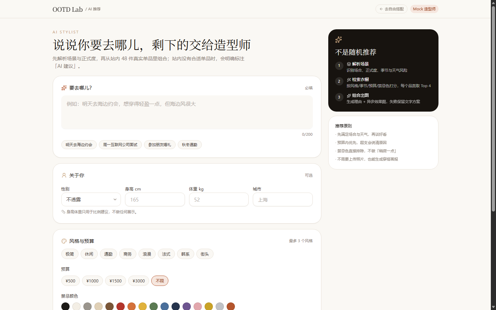
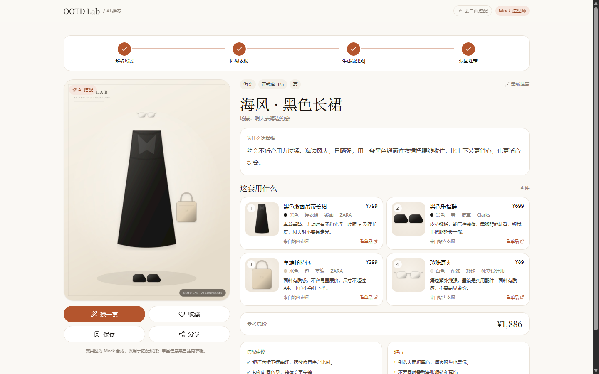

# 模块设计 · AI 推荐（/ai-recommend）

| 项 | 内容 |
| --- | --- |
| 版本 | v1.0 |
| 依赖 | 既有 `Garment` / `Outfit` / `GenerationTask` / `MediaAsset`，新增 `Recommendation` 字段 |
| 无 Key 可跑 | `LLM_PROVIDER=mock` 时用规则引擎生成结构化方案；有 Key 时切 OpenAI 兼容接口 |

---

## 1. 设计决策

| 决策 | 说明 |
| --- | --- |
| **文字先出、图片后出** | `POST /api/ai/recommend` 同步返回结构化方案（<1s），同时创建 `SCENE_RECOMMEND` 任务异步出图；前端拿到文字立刻渲染，图片位显示进度。 |
| **LLM 只做"选择 + 表达"** | 召回、预算、禁忌色、品类完整性由服务端硬约束；LLM 只能在候选白名单内选，避免幻觉商品。 |
| **输出强校验** | Zod Schema 校验；失败自动带错误重试 1 次；仍失败降级到规则引擎（`provider=rule-fallback`），接口不报错。 |
| **图片失败不失败整个推荐** | 任务失败时 `Recommendation.status=DEGRADED`，保留文字方案与单品数据，前端展示"仅文字方案 + 重试"。 |
| **复用 Outfit** | 推荐结果同时落为 `Outfit(source=AI_RECOMMENDATION)` + `OutfitItem`，可直接复用保存/分享/收藏链路；`itemsJson` 保存快照（含 AI 建议项）。 |
| **密钥只在服务端** | `LLM_API_KEY` 仅被 Route Handler / service 读取；前端只拿到方案数据。 |

### 1.1 数据模型变更

```prisma
enum RecommendationStatus {
  PENDING    // 文字已生成，图片生成中
  READY      // 图 + 文都完成
  DEGRADED   // 图片失败，保留文字方案
  FAILED     // 彻底失败（理论上不出现）
}

model Recommendation {
  // 既有：userId / sceneText / parsed / inputs / styleTitle / rationale / tips /
  //       avoidTips / outfitId / taskId / parentId / provider / model / latencyMs
  status        RecommendationStatus @default(PENDING)
  itemsJson     Json?                // 推荐单品快照（含 AI 建议）
  resultImageId String?              // MediaAsset
  imageError    String?              // 图片失败原因（用户可读）
  isFavorite    Boolean  @default(false)
  savedAt       DateTime?
  resultImage   MediaAsset? @relation("RecommendationResult", ...)
}
```

字段映射（对应用户给出的建议模型）：

| 建议字段 | 实际字段 |
| --- | --- |
| `sceneInput` | `sceneText` |
| `profileJson` | `inputs`（性别/身高/体重/风格/预算/城市/天气/禁忌色/正式度） |
| `styleSummary` | `styleTitle` |
| `reason` | `rationale` |
| `itemsJson` | `itemsJson` |
| `resultImageUrl` | `resultImageId → MediaAsset`，DTO 输出 URL |
| `status` | `status` |
| `createdAt` | `createdAt` |

---

## 2. 接口契约

### 2.1 `POST /api/ai/recommend`

```jsonc
// req
{
  "scene": "明天去海边约会",
  "gender": "FEMALE",
  "heightCm": 165,
  "weightKg": 52,
  "styles": ["FRENCH", "ROMANTIC"],
  "budget": 1500,
  "city": "厦门",
  "weather": { "condition": "SUNNY", "tempC": 28 },
  "avoidColors": ["BLACK"],
  "formality": 2,
  "userPhotoId": null,                         // 可选，上传过的照片可直接试穿
  "excludeClothingIds": []                     // 换一套时排除
}
// 201
{
  "recommendation": {
    "id": "cm...",
    "status": "PENDING",
    "scene": "明天去海边约会",
    "styleSummary": "海风法式 · 亚麻长裙",
    "reason": "海边风大、日晒强……",
    "items": [{
      "clothingId": "cm...", "name": "白色亚麻收腰连衣裙", "category": "DRESS",
      "color": "WHITE", "colorHex": "#f3eee5", "material": "亚麻", "style": "FRENCH",
      "imageUrl": "/api/media/...", "price": 690, "purchaseUrl": "https://...",
      "brand": "COS", "reason": "亚麻透气、及踝长度抗风", "isAiSuggested": false
    }],
    "tips": ["草编包 + 细带凉鞋"],
    "avoidTips": ["避免大面积黑色吸热"],
    "budget": { "total": 1448, "limit": 1500, "match": "within", "diff": 52 },
    "parsed": { "occasion": "DATE", "formality": 2, "season": "SUMMER", "riskFlags": ["wind", "sun"] },
    "imageUrl": null, "imageError": null, "isFavorite": false, "savedAt": null,
    "provider": "mock", "createdAt": "..."
  },
  "taskId": "cm...",
  "pollAfterMs": 1500
}
```

### 2.2 `GET /api/ai/recommendations/:id`

```jsonc
{
  "recommendation": { /* 同上，图片完成后 imageUrl 有值 */ },
  "task": { "id": "cm...", "status": "RUNNING", "progress": 48, "error": null }
}
```

### 2.3 `GET /api/ai/recommendations/mine`

```jsonc
{ "items": [ { "id": "...", "styleSummary": "...", "imageUrl": "...", "status": "READY", "isFavorite": true, "createdAt": "..." } ] }
```

### 2.4 收藏 / 保存 / 分享 / 换一套（辅助）

| 方法 | 路径 | 说明 |
| --- | --- | --- |
| POST | `/api/ai/recommendations/:id/favorite` | toggle，返回 `{ favorited }` |
| POST | `/api/ai/recommendations/:id/save` | 标记 `savedAt`，Outfit 状态置 `SAVED` |
| POST | `/api/ai/recommendations/:id/share` | 创建关联帖子，返回 `{ post }` |
| POST | `/api/ai/recommendations/:id/reroll` | 复用原输入 + 排除已选 + 新随机种子，返回同 2.1 |
| POST | `/api/ai/recommendations/:id/retry-image` | 图片失败后重试生成，返回 `{ taskId }` |

### 2.5 错误码

`VALIDATION_ERROR(400)`、`NOT_FOUND(404)`、`FORBIDDEN(403)`、`BUDGET_TOO_LOW(422)`（预算低于 100 元）、`NO_CANDIDATES(422)`、`IMAGE_FAILED(200 + DEGRADED)`。

---

## 3. Prompt 模板

### 3.1 System Prompt

```text
你是 OOTD Lab 的资深造型师，擅长把「场景 + 身材 + 预算」翻译成可执行的穿搭方案。
你会收到：场景解析结果、用户画像、候选单品清单（来自站内数据库）。

硬性规则：
1. 只能从候选清单中选择 clothingId；候选不足时才可给 isAiSuggested=true 的补充建议，且不得编造品牌、价格、购买链接。
2. 一套方案必须覆盖：一条连衣裙，或上装 + 下装；必须包含鞋。外套根据季节与正式度决定，包/配饰可选。
3. 禁忌颜色不得出现；预算是软约束，超支必须在 reason 中说明理由（例如"外套可省略，用现有风衣替代"）。
4. reason 必须自然、具体：引用材质、版型、颜色、天气、场合、身材比例中的至少两个要素；禁止"很好看""很百搭""提升气质"这类空话。
5. 只输出 JSON，不要 markdown 代码块，不要解释，不要新增字段。
```

### 3.2 User Prompt（模板）

```text
【场景】
{{scene}}

【场景解析】
场合={{occasion}}；正式度={{formality}}/5；季节={{season}}；天气={{weather}}；风险={{riskFlags}}

【用户画像】
性别={{gender}}；身高={{heightCm}}cm；体重={{weightKg}}kg；风格偏好={{styles}}；预算=¥{{budget}}；禁忌色={{avoidColors}}；城市={{city}}

【候选单品】（只能从中选择，最多 12 件展示）
{{#each candidates}}
- id={{id}} | {{name}} | {{category}} | {{color}} | {{material}} | {{styles}} | {{seasons}} | ¥{{price}} | {{brand}}
{{/each}}

【输出 JSON Schema】
{
  "scene": "string",
  "styleSummary": "8-20 字风格标题",
  "reason": "60-200 字，具体到材质/版型/天气/场合/比例",
  "items": [
    {
      "clothingId": "候选 id 或 null",
      "name": "string",
      "category": "TOP|BOTTOM|DRESS|OUTERWEAR|SHOES|BAG|ACCESSORY",
      "color": "string",
      "material": "string",
      "style": "string",
      "price": 0,
      "purchaseUrl": "string",
      "reason": "20-60 字，说明为什么适合这个场景",
      "isAiSuggested": false
    }
  ],
  "imagePrompt": "英文，用于图像模型：场景 + 单品 + 光线 + 构图 + 3:4",
  "tips": ["最多 4 条"],
  "avoidTips": ["最多 3 条"]
}

要求：2-6 件单品；先判断连衣裙或上下装，再补鞋与配饰；总价尽量贴近预算。
```

### 3.3 校验失败重试 Prompt（追加）

```text
上一次输出未通过 JSON Schema 校验，错误如下：
{{zodIssues}}

请严格按 Schema 重新输出完整 JSON：不要新增字段，不要 markdown，items 必须 2-6 件。
```

### 3.4 JSON Schema 校验（服务端 Zod）

```ts
const Item = z.object({
  clothingId: z.string().nullable().optional(),
  name: z.string().min(1).max(60),
  category: z.enum([...]),
  color: z.string().max(20).optional(),
  material: z.string().max(40).optional(),
  style: z.string().max(20).optional(),
  price: z.number().nonnegative().optional(),
  purchaseUrl: z.string().max(500).optional(),
  reason: z.string().min(8).max(120),
  isAiSuggested: z.boolean().optional(),
});
const Draft = z.object({
  scene: z.string().max(200).optional(),
  styleSummary: z.string().min(4).max(40),
  reason: z.string().min(20).max(400),
  items: z.array(Item).min(2).max(6),
  imagePrompt: z.string().min(10).max(600),
  tips: z.array(z.string().max(80)).max(4).default([]),
  avoidTips: z.array(z.string().max(80)).max(3).default([]),
});
```

**归一化**：`clothingId` 不在候选白名单 → 视为 AI 建议（清空价格/链接）；命中则用数据库字段覆盖 LLM 返回的名称/价格，防止编造。

---

## 4. 检索与排序

1. 取全部 `PUBLISHED` 平台单品（当前 48 件，全量打分；生产可换 pgvector + SQL 预筛）。
2. 硬过滤：禁忌主色、排除 ID、预算上限（价格 ≤ 预算 × 1.15）。
3. 打分：`风格命中 ×3 + 季节命中 ×2 + 正式度匹配 ×2 + 场景关键词 ×2 + 热度`。
4. 按品类各取 Top 3 作为候选（候选池 ≤ 18），保证连衣裙/上下装/鞋/外套/包/配饰都有备选。
5. 品类缺口 → 生成 `isAiSuggested` 建议项，并在 reason 中说明"站内暂无合适 XX"。

## 5. 降级策略

| 失败点 | 表现 |
| --- | --- |
| LLM 超时 / 非 JSON / Schema 失败 | 重试 1 次 → 规则引擎生成，`provider=rule-fallback`，接口 201 |
| 召回为空 | 用宽松条件（去掉预算）再召回；仍为空 → 纯 AI 建议方案 |
| 图片生成失败 | `status=DEGRADED` + `imageError`；文字/单品/预算完整保留 |
| 图片超时 | 任务 `FAILED`，同 DEGRADED，前端可点"重试出图" |

## 6. 页面与组件

```
app/ai-recommend/page.tsx
└─ features/recommend/components/recommend-shell.tsx
   ├─ recommend-form.tsx          场景、画像、偏好、预算、天气、正式度
   ├─ recommend-stepper.tsx       解析场景 → 匹配衣服 → 生成效果图 → 返回推荐
   ├─ recommend-result.tsx        效果图 + 风格总结 + 理由 + 清单 + 预算
   │  ├─ budget-meter.tsx
   │  ├─ item-card.tsx
   │  └─ recommend-actions.tsx    换一套 / 收藏 / 保存 / 分享
   └─ share-dialog.tsx
```

状态：`phase: form | result`；`recommendation` 由 React Query 轮询（`status=PENDING` 时 1.5s）；表单值在换一套时保留。

## 7. 验收清单

- [ ] 场景为空/超 200 字时前端阻止提交，后端 400。
- [ ] Mock 模式下 5 个不同场景输出组合合法（无连衣裙 + 上下装、必有鞋）。
- [ ] 禁忌色不出现在结果中（DB 单品）。
- [ ] 预算 500 时总价 ≤ 575，或明确标注超支原因。
- [ ] LLM 返回非法 JSON 时自动重试一次，仍失败走规则引擎，无 500。
- [ ] 图片失败时文字方案可用，页面显示"图片生成失败"与重试。
- [ ] 换一套后与上一套重合 ≤ 60%。
- [ ] 收藏/保存/分享状态可刷新保持。
- [ ] 390px 无横向溢出，表单可单手完成。

## 8. 截图

| 表单 | 结果 |
| --- | --- |
|  |  |

## 9. 已实测

- `POST /api/ai/recommend` 返回 201，文字 <1s，图片约 1.5s 完成。
- 海边约会 / 面试 / 低预算三个场景组合合法；低预算时正确输出 3 件并标注 2 件 AI 建议，无重复品类。
- 换一套与上一套单品重合 0/4。
- 收藏、保存、分享、详情、mine 全部 200/201。
- 单元测试覆盖：Schema 失败重试、两次失败降级规则引擎、幻觉 clothingId 清洗。
- 浏览器全流程无 console error；390px 无横向溢出。
