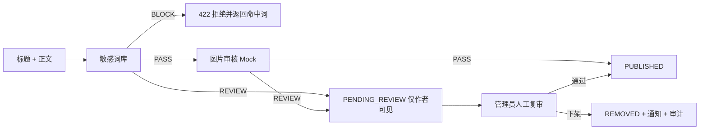
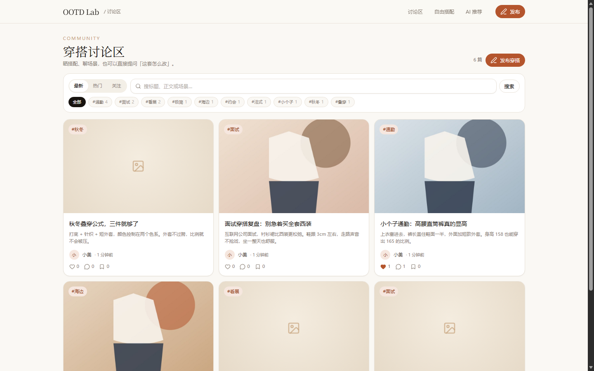
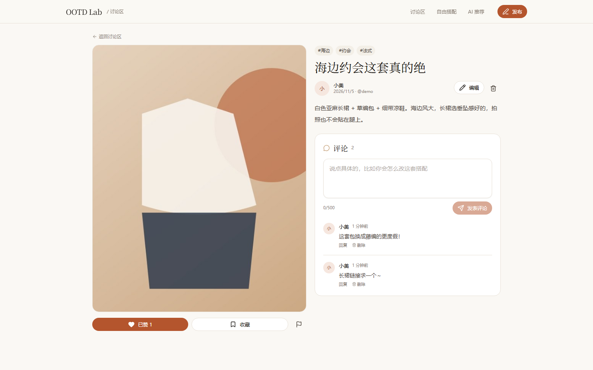
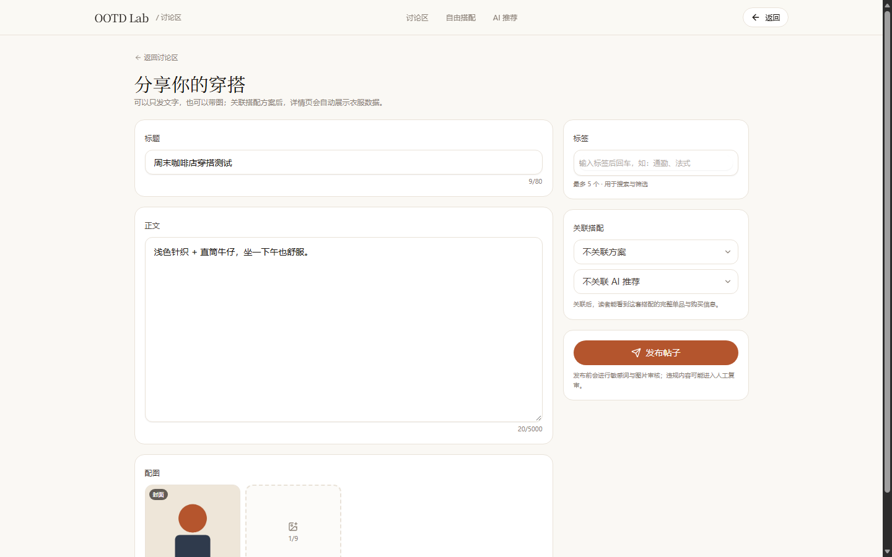
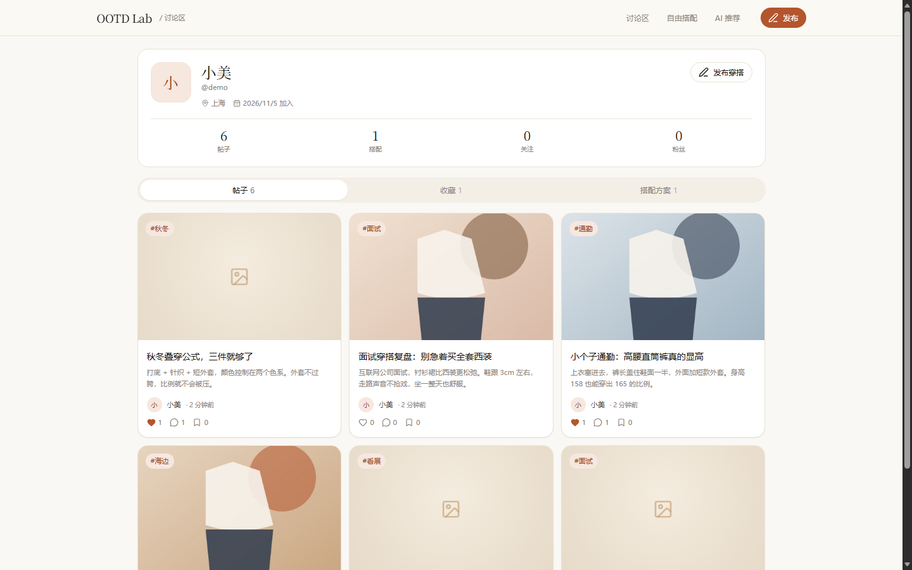

# 模块设计 · 用户讨论区（/community）

| 项 | 内容 |
| --- | --- |
| 版本 | v1.0 |
| 依赖 | 既有 Post / Comment / Tag / PostLike / PostBookmark / Report / Follow，新增 `Post.recommendationId` |
| 页面 | `/community`、`/community/new`、`/community/[id]`、`/community/[id]/edit`、`/profile/[userId]` |
| 无外部依赖 | 图片存本地对象存储；敏感词用数据库词库；图片机审预留 Provider |

---

## 1. 数据模型

你给出的模型与既有 schema 的映射：

| 你的建议 | 实际实现 | 说明 |
| --- | --- | --- |
| `Post.imagesJson` | `PostImage` 关联表 | 有序图片（position），图片本身是 `MediaAsset(kind=POST_IMAGE, visibility=PUBLIC)` |
| `Post.tagsJson` | `Tag` + `PostTag` | 标签可复用、可统计使用次数、支持筛选 |
| `Post.outfitId` | `Post.outfitId` | 关联搭配方案，详情页自动展开单品 |
| `Post.recommendationId` | **新增** `Post.recommendationId` | 关联 AI 推荐，详情页展示风格总结 + 理由 + 单品 |
| `Post.content` | `Post.body` | 保持既有命名，API 层同时接受 `content` / `body` |
| `Post.status` | `Post.status` | `DRAFT/PENDING_REVIEW/PUBLISHED/REJECTED/REMOVED/DELETED` |
| `Comment.content` | `Comment.body` | 一级评论 + 一级回复（`parentId`） |
| `Like` | `PostLike` / `CommentLike` | 复合主键 `(postId,userId)`，天然幂等 |
| `Favorite` | `PostBookmark` | 收藏帖子；搭配收藏走 `OutfitFavorite` |
| `Report` | `Report` | `targetType=POST/COMMENT/USER`，多态 targetId |

**新增字段**（迁移 `0003_community`）：

```prisma
model Post {
  recommendationId String?        @map("recommendation_id")
  recommendation   Recommendation? @relation(fields: [recommendationId], references: [id], onDelete: SetNull)
  @@index([recommendationId])
}
```

计数冗余：`likeCount / commentCount / bookmarkCount / viewCount / hotScore`，互动时同事务增减并重算热度。

热度公式：`(点赞×3 + 评论×5 + 收藏×4) / (发布小时数 + 2)^1.5`。

---

## 2. 接口契约

### 2.1 信息流

`GET /api/posts?sort=latest|hot|following&tag=&q=&page=1&limit=12`

```jsonc
{
  "items": [{
    "id": "cm...", "title": "海边约会这套真的绝", "excerpt": "白色亚麻长裙 + 草编包…",
    "coverUrl": "/api/media/...", "author": { "id": "...", "name": "小美", "handle": "demo", "avatarUrl": null },
    "tags": [{ "id": "...", "name": "海边", "slug": "tag-1a2b" }],
    "likeCount": 1, "commentCount": 2, "bookmarkCount": 0,
    "liked": true, "favorited": false, "status": "PUBLISHED", "createdAt": "..."
  }],
  "page": 1, "total": 7, "hasMore": false
}
```

- 仅返回 `PUBLISHED` 且未删除；`following` 取当前用户关注作者。
- 标签支持按 `name` 或 `slug` 过滤；`q` 同时匹配标题与正文。

### 2.2 帖子 CRUD

| 方法 | 路径 | 说明 |
| --- | --- | --- |
| POST | `/api/posts` | 创建；`{title,content,imageIds[],tags[],outfitId?,recommendationId?}` |
| GET | `/api/posts/:id` | 详情（作者可看审核中/已下架） |
| PATCH | `/api/posts/:id` | 作者/管理员编辑，重新审核 |
| DELETE | `/api/posts/:id` | 软删（`status=DELETED`） |
| POST | `/api/posts/:id/like` | toggle `{liked,likeCount}` |
| POST | `/api/posts/:id/favorite` | toggle `{favorited,bookmarkCount}` |
| GET | `/api/posts/:id/comments?page=` | 一级评论 + 回复，分页 |
| POST | `/api/posts/:id/comments` | `{content,parentId?}` |
| DELETE | `/api/comments/:id` | 评论作者 / 楼主 / 管理员 |
| POST | `/api/reports` | `{targetType,targetId,reason,detail?}` |
| POST | `/api/community/images` | multipart `files[]`，≤9 张、≤10MB/张 |
| GET | `/api/tags?limit=14` | 热门标签 |
| GET | `/api/users/:id/profile` | 主页聚合（帖子/收藏/方案/关注态） |
| POST | `/api/users/:id/follow` | 关注 toggle |
| POST | `/api/admin/posts/:id/takedown` | 管理员下架（写通知 + 审计） |

### 2.3 权限矩阵

| 操作 | 游客 | 登录 | 作者 | 管理员 |
| --- | --- | --- | --- | --- |
| 浏览已发布帖子 | ✅ | ✅ | ✅ | ✅ |
| 查看审核中/已下架 | ❌ | ❌ | ✅ | ✅ |
| 发帖 / 评论 / 点赞 / 收藏 / 举报 | ❌ | ✅ | ✅ | ✅ |
| 编辑 / 删除帖子 | ❌ | ❌ | ✅ | ✅ |
| 删除他人评论 | ❌ | ❌ | 楼主可删自己帖子下的评论 | ✅ |
| 下架帖子 | ❌ | ❌ | ❌ | ✅ |

> 当前仍是演示身份（`demo@ootd.local`）；把 `DEMO_USER_EMAIL` 指向种子管理员 `admin@ootd.local` 可验证管理员链路。

### 2.4 错误码

`VALIDATION_ERROR(400)`、`UNAUTHENTICATED(401)`、`FORBIDDEN(403)`、`NOT_FOUND(404)`、`ALREADY_REPORTED(409)`、`CONTENT_BLOCKED(422)`、`TOO_MANY_IMAGES(422)`、`FILE_TOO_LARGE(413)`、`UNSUPPORTED_MEDIA_TYPE(415)`。

---

## 3. 内容审核



- 词库：`SensitiveTerm`（种子 20 条，BLOCK 17 / REVIEW 3），支持后台热更新。
- 图片审核：`moderateImages()` 预留 `IMAGE_MODERATION_PROVIDER`，默认 mock 通过。
- 管理员下架：写 `Notification(MODERATION)` + `AuditLog(POST_TAKEDOWN)`。

---

## 4. 组件拆分

```
app/community/page.tsx                 RSC 壳
└─ features/community/components/community-feed.tsx
   ├─ community-header.tsx             桌面/移动导航
   ├─ post-card.tsx                    封面/标题/摘要/作者/标签/计数
   └─ 骨架 / 空态 / 错误 / 加载更多

app/community/new/page.tsx
└─ post-editor.tsx
   ├─ image-uploader.tsx               多图上传（≤9，封面标记，删除）
   ├─ tag-input.tsx                    Enter 添加、Backspace 删除、≤5
   └─ 关联选择器（我的搭配 / AI 推荐）

app/community/[id]/page.tsx
└─ post-detail.tsx
   ├─ 图片轮播（箭头 / 圆点）
   ├─ 作者行（关注 / 编辑 / 删除）
   ├─ 衣服数据（Outfit 或 Recommendation）
   ├─ comment-section.tsx              评论 + 回复 + 分页 + 删除
   └─ report-dialog.tsx

app/profile/[userId]/page.tsx
└─ profile-view.tsx                    资料 / 统计 / 关注 / 帖子·收藏·搭配 Tabs
```

**状态设计**：每页都有 loading 骨架、空状态文案（区分「还没有帖子」「没有搜到」「关注列表为空」）、错误重试；图片懒加载；移动端单列 + 横向滚动标签。

---

## 5. 验收与实测

- [x] 发帖后立即出现在最新流；审核中不进流、作者可访问。
- [x] 敏感词 BLOCK 返回命中词；REVIEW 进入待审。
- [x] 点赞/收藏 toggle 幂等，计数与 `liked/favorited` 同步。
- [x] 评论 + 一级回复、分页、楼主删评。
- [x] 标签筛选、关键词搜索、热门排序、分页。
- [x] 关联 AI 推荐时详情自动展示风格总结与 2 件单品。
- [x] 上传图片（≤9、≤10MB）后自动成为封面。
- [x] 举报去重（409）；个人主页聚合。
- [x] 390px 无横向溢出，桌面 1440px 三列信息流。

## 6. 截图

| 信息流 | 帖子详情 |
| --- | --- |
|  |  |

| 发布页 | 个人主页 |
| --- | --- |
|  |  |

## 7. 已知边界

- 无独立登录页与管理员后台 UI；管理员下架目前是 API + 种子管理员。
- 分享时若 AI 推荐图尚未生成，帖子封面为空（文字与单品数据仍完整）。
- 关联搭配的封面可能来自私密试衣图；其他用户访问时受媒体权限限制（接入登录后需在分享时复制为公开封面）。
- 评论仅支持一级回复；暂不支持评论点赞和 @ 提醒。
- 图片审核为 mock，接入第三方后按 `REVIEW` 走待审。
