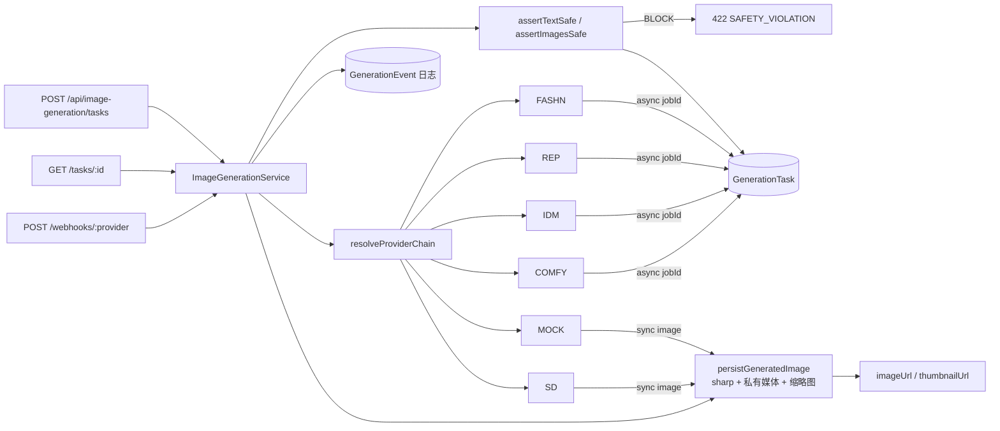
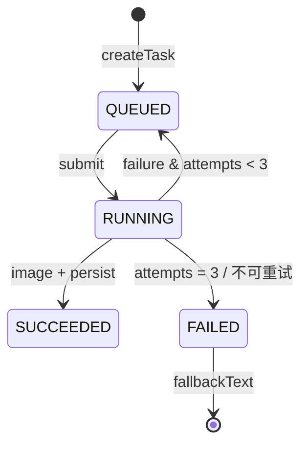

# 图像生成服务抽象层（ImageGenerationService）

| 项 | 内容 |
| --- | --- |
| 代码 | `src/server/ai/generation/*` |
| API | `POST /api/image-generation/tasks`、`GET /api/image-generation/tasks/:id`、`POST /api/image-generation/webhooks/:provider` |
| 前端 | `src/features/image-generation/use-generation-task.ts` |
| 默认 | `IMAGE_PROVIDER_CHAIN=mock`，零 Key 可跑 |
| 迁移 | `0004_image_providers`（新增 `STABLE_DIFFUSION`、`IDM_VTON` 枚举值） |

---

## 1. 设计目标

1. **供应商可替换**：业务层只依赖 `ImageGenerationService` 接口，不出现任何 Fashn/Replicate 字段。
2. **统一异步模型**：`create → queued/processing → succeeded/failed`，同步供应商（Mock、SD WebUI）也走同一任务表。
3. **失败可恢复**：提交/轮询失败自动重试 2 次（共 3 次），按供应商链降级；最终失败返回文字方案。
4. **内容安全前置**：文本检查在创建任务前完成，违规请求不消耗供应商额度。
5. **可排查**：每次状态变化写 `GenerationEvent`，`getTask` 返回最近 40 条日志。
6. **图片落库**：供应商返回的图片重新编码后写入私有媒体，输出站内 URL + 缩略图，不直接暴露供应商临时链接。

## 2. 接口与类型

```ts
export interface ImageGenerationService {
  generateTryOn(input: TryOnInput & { userId: string }): Promise<GenerationResult>
  generateRecommendation(
    input: RecommendationImageInput & { userId: string },
  ): Promise<GenerationResult>
  getTask(userId: string, taskId: string): Promise<GenerationTaskStatus>
  handleWebhook(provider: string, headers: Headers, rawBody: string): Promise<{ received: boolean }>
}
```

```ts
interface TryOnInput {
  userPhotoUrl: string
  clothingImageUrls: string[]
  scene?: string
  stylePrompt?: string
  negativePrompt?: string
  width?: number
  height?: number
  seed?: number
  poseHint?: 'standing' | 'walking' | 'sitting'
  preserveFace?: boolean
  metadata?: Record<string, unknown>
}

interface RecommendationImageInput {
  userPhotoUrl?: string | null
  clothingImageUrls: string[]
  scene?: string
  stylePrompt?: string
  negativePrompt?: string
  width?: number
  height?: number
  seed?: number
  styleSummary?: string
  metadata?: Record<string, unknown>
}

interface GenerationResult {
  taskId: string
  status: 'queued' | 'processing' | 'succeeded' | 'failed' | 'canceled'
  provider: ImageProviderId
  progress: number
  imageUrl?: string
  thumbnailUrl?: string
  width?: number
  height?: number
  durationMs?: number
  error?: { code: string; message: string; retryable: boolean }
  fallbackText?: string
}
```

`GenerationTaskStatus` 在此基础上增加 `attempts / createdAt / updatedAt / providerJobId / logs[]`。

## 3. 分层



## 4. 供应商适配器

| 供应商 | 类 | 类型 | 能力 | 关键环境变量 |
| --- | --- | --- | --- | --- |
| Mock（sharp 合成） | `MockImageProvider` | 同步 | 试衣 + 画报 | 无 |
| Fashn | `FashnProvider` | 异步 | 仅试衣（单件） | `FASHN_API_KEY` |
| Replicate（通用） | `ReplicateProvider` | 异步 | 试衣 + 画报 | `REPLICATE_API_TOKEN`、`REPLICATE_MODEL_VERSION` |
| IDM-VTON（Replicate） | `IdmVtonProvider` | 异步 | 仅试衣 | `REPLICATE_API_TOKEN`、`REPLICATE_IDM_VTON_VERSION` |
| ComfyUI（自建） | `ComfyUIProvider` | 异步 | 试衣 + 画报 | `COMFYUI_BASE_URL`、`COMFYUI_WORKFLOW_PATH` |
| Stable Diffusion WebUI | `StableDiffusionProvider` | 同步 | img2img / txt2img | `SD_API_URL` |

**抽象基类** `BaseImageProvider` 提供：

- `requireEnv()`：缺失配置直接抛不可重试错误；
- `fetchJson()`：统一超时、HTTP 错误映射（429/5xx 可重试）；
- `submit()` / `poll()` 模板由子类实现；
- 可选 `verifyWebhook` / `parseWebhook`。

**供应商链**：`IMAGE_PROVIDER_CHAIN=fashn,replicate,mock`，按顺序尝试；未配置 Key 的自动跳过。重试时切换到下一个供应商，全部失败后回退 Mock。

## 5. 任务状态机与失败策略



- **重试 2 次**：`attempts` 1→2→3；每次按链切换到下一个可用供应商。
- **不可重试**：安全拒绝、参数错误、401/403。
- **降级**：最终失败写 `output.fallbackText`，`status=failed`，前端展示文字方案（AI 推荐可直接用 `rationale`，试衣用单品清单）。
- **Webhook**：`x-image-signature: sha256=<hmac>`，按 `providerJobId` 定位任务；签名错误 401，未知任务返回 200 防止重试风暴。

## 6. 内容安全

- 文本检查字段：`scene`、`stylePrompt`、`styleSummary`、`metadata` 中的字符串。
- 命中词库 → `422 SAFETY_VIOLATION`，返回 `details.matches`；不创建任务、不计费。
- `negativePrompt` 不拦截（用户用它排除 nsfw）。
- 图片检查：`IMAGE_SAFETY_PROVIDER` 预留；默认 mock 通过，接入第三方后可在创建任务前 REVIEW/BLOCK。

## 7. API 示例

```bash
# 创建试衣任务
curl -X POST http://localhost:3000/api/image-generation/tasks \
  -H 'Content-Type: application/json' \
  -d '{
    "kind": "tryon",
    "userPhotoUrl": "/api/media/<photoId>",
    "clothingImageUrls": ["/api/media/<dressId>", "/api/media/<shoesId>"],
    "scene": "明天去海边约会",
    "stylePrompt": "轻盈法式度假，浅色亚麻长裙，自然光，全身",
    "negativePrompt": "low quality, blurry, extra fingers",
    "width": 1024,
    "height": 1365,
    "seed": 7
  }'

# 轮询
curl http://localhost:3000/api/image-generation/tasks/<taskId>
```

响应（Mock 同步完成）：

```json
{
  "taskId": "cm...",
  "status": "succeeded",
  "provider": "mock",
  "progress": 100,
  "imageUrl": "/api/media/...",
  "thumbnailUrl": "/api/media/...",
  "width": 1024,
  "height": 1365,
  "durationMs": 380,
  "attempts": 1,
  "logs": [{ "status": "QUEUED", "message": "任务创建" }]
}
```

## 8. 前端 Hook

```tsx
'use client'
import { useGenerationTask } from '@/features/image-generation/use-generation-task'

export function ResultPanel({ taskId }: { taskId: string | null }) {
  const { task, loading, error, isPolling, refresh } = useGenerationTask(taskId, {
    intervalMs: 1500,
  })

  if (loading && !task) return <Skeleton />
  if (error) return <button onClick={refresh}>重试：{error}</button>
  if (task?.status === 'failed') return <p>{task.fallbackText}</p>

  return (
    <div>
      {task?.imageUrl ?  : <p>生成中 {task?.progress}%</p>}
      {isPolling ? <span>正在生成…</span> : null}
    </div>
  )
}
```

Hook 行为：终态自动停止、失败指数退避（1.5s → 3s → 6s，上限 8s）、`refresh()` 手动重试。

## 9. 日志

每次 `create/submit/poll/retry/success/fail` 写 `GenerationEvent`：

```json
{ "status": "RUNNING", "message": "任务已提交 fashn-job-1", "payload": { "provider": "fashn", "attempt": 1 } }
```

`GET /api/image-generation/tasks/:id` 返回最近 40 条，管理端可直接展示时间线。控制台同时输出 `[image-generation]` 前缀的结构化日志（不含 Key/签名）。

## 10. 与现有模块的关系

当前 `/outfit-studio`、`/ai-recommend` 仍使用 `CompositeImageService`（纯 sharp 合成，便于演示）。抽象层已经独立可用，迁移步骤：

1. 在 `tryon.service.ts` 把 `createTryOn` 改为调用 `imageGenerationService.generateTryOn({... userId})`；
2. `GET /api/generation/tasks/:id` 改为 `getTask` 并映射为现有 `TryOnTask` DTO；
3. 推荐服务把 `itemsJson` 中的图片 URL 传给 `generateRecommendation`，保留文字先行逻辑；
4. 删除 `CompositeImageService` 或保留为 `mock` 供应商的底层实现。

这样供应商切换只改 `.env`，不动前端与业务路由。

## 11. 环境变量

```dotenv
IMAGE_PROVIDER_CHAIN=mock          # fashn,replicate,mock
IMAGE_MAX_ATTEMPTS=3
APP_URL=http://localhost:3000
IMAGE_WEBHOOK_SECRET=              # 生产必填
IMAGE_SAFETY_PROVIDER=mock

FASHN_API_KEY=
FASHN_BASE_URL=https://api.fashn.ai/v1

REPLICATE_API_TOKEN=
REPLICATE_MODEL_VERSION=
REPLICATE_IDM_VTON_VERSION=

COMFYUI_BASE_URL=
COMFYUI_API_KEY=
COMFYUI_WORKFLOW_PATH=

SD_API_URL=
SD_API_KEY=
SD_STEPS=28
SD_CFG=6
SD_SAMPLER=DPM++ 2M Karras
SD_DENOISING=0.55
```

## 12. 已验证 / 已知边界

- ✅ Mock 同步试衣：1024×1365，380ms，落库 + 缩略图 + 3 条日志。
- ✅ 画报模式（无用户照片）。
- ✅ 安全拦截：`"海边裸体写真"` → 422，命中「裸体」。
- ✅ Webhook 错误签名 → 401。
- ✅ 供应商链重试：Fashn 401 → 自动切 Mock 成功（`attempts=2`）。
- ✅ 全部失败 → `FAILED` + `fallbackText`。
- ⚠️ Fashn 只支持单件 garment；多件需先合成或改用 Replicate/IDM-VTON。
- ⚠️ 外部供应商需要可公网访问的图片 URL；本地开发用 Mock 或配置 `APP_URL` + 内网穿透。
- ⚠️ Webhook 的 Fashn 适配器未实现 `parseWebhook`，当前以轮询为主；Replicate 已实现。
- ⚠️ 真实供应商未做端到端联调（无 Key），请求/响应字段按官方文档实现。
