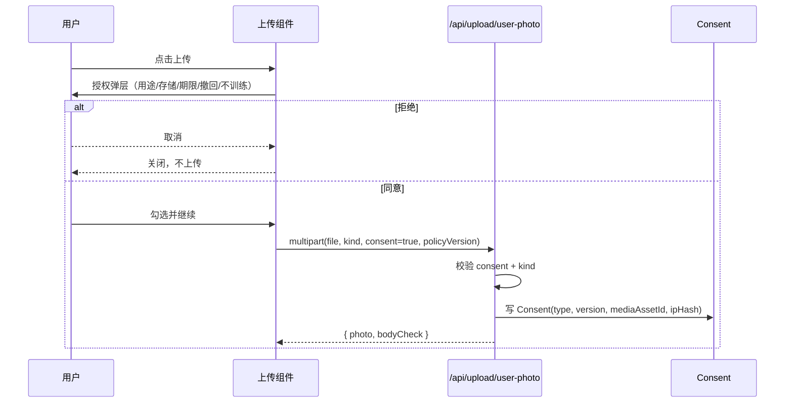

# 隐私与安全设计（Privacy & Security）

| 项 | 内容 |
| --- | --- |
| 版本 | v1.0 |
| 适用 | 自由搭配、AI 推荐、讨论区、图像生成抽象层 |
| 依据 | 《个人信息保护法》（单独同意/告知/撤回/删除/不用于训练）、GDPR 对应条款 |
| 关联 | [PRD](01-PRD.md) · [架构](02-architecture.md) · [验收测试](13-acceptance-test-plan.md) |

---

## 1. 原则

1. **最小化**：只收集生成效果必需的照片与身体数据；不采集身份证、精确位置、通讯录。
2. **默认私密**：用户照片与生成结果默认 `PRIVATE`，不进入信息流、不被搜索引擎索引。
3. **显式同意**：人脸/全身照上传前弹层说明，必须主动确认；拒绝即不可上传。
4. **可撤回、可删除**：撤回同意立即停止使用并删除源图；账号与数据可删除。
5. **不训练**：用户照片不进入任何模型训练/微调数据集；供应商调用需带 opt-out 约定。
6. **可审计**：授权、删除、分享、下架等敏感操作写 `AuditLog` / `Consent`。

---

## 2. 数据资产清单

| 数据 | 表/存储 | 加密 | 可见性 | 保留 | 删除方式 |
| --- | --- | --- | --- | --- | --- |
| 人脸照 | `media_assets(kind=FACE)` + `.enc` | AES-256-GCM | 仅 owner | 180 天 | 用户删除 / 撤回 / 到期任务 |
| 全身照 | `media_assets(kind=FULL_BODY)` + `.enc` | AES-256-GCM | 仅 owner | 180 天 | 同上 |
| 生成结果 | `media_assets(kind=RESULT)` | 无（私有桶 + 鉴权代理） | 仅 owner | 随方案 | 删除方案/结果 |
| 帖子图片 | `media_assets(kind=POST_IMAGE)` | 无（公开内容） | PUBLIC | 随帖子 | 删帖/下架 |
| 衣服图（自有） | `media_assets(kind=GARMENT_*)` | 无 | 仅 owner | 随单品 | 删除单品 |
| 授权记录 | `consents` | 数据库 | 本人 + 管理员 | 3 年（审计） | 不删除，标记撤回 |
| 身体数据 | `profiles(height/weight)` | 数据库 | 本人；不公开 | 账号存续 | 修改/注销 |
| 帖子/评论 | `posts/comments` | 数据库 | 公开 | 账号存续 | 软删 |
| 举报 | `reports` | 数据库 | 举报人/管理员 | 2 年 | 保留审计 |
| 审计日志 | `audit_logs` | 数据库 | 管理员 | 1 年 | 归档 |
| IP | 仅 `sha256(ip + salt)` | 哈希 | 管理员 | 1 年 | 随日志 |

---

## 3. 授权流程

**硬性规则**

- `kind=face` 与 `kind=body` 都要求 `consent=true`；当前仅 face 在服务端强校验、body 只弹层 —— **待补**。
- `Consent` 至少记录：`type`、`policyVersion`、`grantedAt`、`ipHash`、`userAgent`、`mediaAssetId`。
- 撤回同意：写 `revokedAt`，停止新任务，异步删除该用户全部 FACE 媒体，结果保留但不再展示人脸原图。
- 未成年人：v1 未做年龄门槛；若上线需增加年龄声明与监护人同意（P1）。

**文案要求**：用途、存储方式、保留期限、撤回入口、不用于训练、共享范围（默认不公开）。

---

## 4. 访问控制

| 资源 | 规则 | 当前实现 |
| --- | --- | --- |
| 人脸/全身照 | 仅 owner，短 TTL，`no-store` | ✅ 加密 + 鉴权代理 |
| 生成结果 | 仅 owner；分享时需显式发布 | ⚠️ 私有，但公开帖引用私图会 404 |
| 自有衣服 | 仅 owner | ✅ |
| 站内商品图 | 公开 | ✅ |
| 帖子图片 | 公开 | ✅ |
| 帖子草稿/审核中 | 作者/管理员 | ✅ |
| 管理接口 | `role=ADMIN` | ✅ `requireAdmin` / 服务层角色校验 |

**媒体读取**：`GET /api/media/:id` 校验 owner 或 `visibility=PUBLIC`；敏感图解密后 `Cache-Control: private, no-store`。生产建议改为 **私有 Bucket + 预签名 URL（60s）**，不让图片字节流经应用服务器。

---

## 5. 存储与加密

- **算法**：AES-256-GCM，格式 `[iv 12][tag 16][ciphertext]`；每个文件独立 DEK，KEK 来自 KMS/环境变量。
- **密钥**：`MEDIA_KEK` 32 字节 base64；生产必须放 KMS/Secrets Manager，禁止入库、禁止进 Git。
- **Bucket**：私有 ACL，禁止公共读；仅通过应用鉴权或签名 URL 访问。
- **上传校验**：magic bytes、sharp 解码、像素上限、剥离 EXIF/GPS、重编码（防 polyglot）。
- **CDN**：公开帖子图走 CDN 长缓存；敏感图绝不进 CDN。
- **备份**：数据库加密备份；对象存储版本化；删除需覆盖备份生命周期（P1）。

---

## 6. 删除与保留

| 对象 | 行为 | 当前 |
| --- | --- | --- |
| 单张照片 | 软删记录 + 立即删对象 + key 失效 | ✅ `/api/upload/user-photo/:id` |
| 单张生成结果 | 删除媒体 + 解除方案引用 | ❌ 未提供 |
| 方案 | 软删 + 解绑帖子 | ⚠️ 无 UI/接口 |
| 帖子 | 软删，评论保留但不可见 | ✅ |
| 评论 | 软删，内容替换 | ✅ |
| 账号 | 软删 30 天 → 物理删除所有数据 + 对象前缀 | ❌ 未提供 |
| 数据导出 | 异步 JSON 压缩包，24h 有效 | ❌ 未提供 |

**删除传播**：`User` → Profile/Consent/Media/Outfit/Post/Comment；对象存储按 `users/{id}/` 前缀清理；`AuditLog.actorId` 置空保留。

**保留期任务**：每日清理过期人脸（180 天）、`PENDING` 上传（24h）、已读通知（90 天）、软删 30 天账号。

---

## 7. 不用于模型训练

- 产品文案、隐私政策、授权弹层三处明确声明。
- 供应商调用约定：请求元数据带 `training_opt_out=true` / DPA 条款；禁止把用户图放入供应商公开数据集。
- 自建 ComfyUI/SD：仅推理，不落训练集；不使用用户图做 LoRA/微调。
- 日志与监控：禁止记录图片 base64、签名 URL、人脸特征向量。
- 审核：代码评审检查新增 provider 是否遵守 opt-out；每年复核供应商条款。

---

## 8. 内容安全与审核

| 层 | 实现 | 状态 |
| --- | --- | --- |
| 文本敏感词 | `SensitiveTerm`，BLOCK/REVIEW 两级 | ✅ |
| 图片审核 | `moderateImages()` Provider 预留，默认 mock | ⚠️ 未接真实服务 |
| 发布策略 | BLOCK 拒绝；REVIEW → `PENDING_REVIEW` | ✅ |
| 举报 | 去重 + 后台队列表 | ✅（无后台 UI） |
| 管理员下架 | API + 通知 + 审计 | ✅ API |
| 生成内容 | 安全词前置校验 + 供应商负面词 | ✅ |

---

## 9. API 安全

### 9.1 鉴权

- 目标：Auth.js 邮箱登录 + HttpOnly/Secure/SameSite=Lax Cookie；30 天滑动过期；登出即失效。
- 现状：Auth.js Credentials 已接入；`requireUser` 从会话读取，未登录 401；注册/登录/注销完整。演示账号仅用于本地种子。
- 资源查询必须带 `ownerId/authorId` 条件；管理接口 `role=ADMIN`。

### 9.2 速率限制

目标（Redis 滑窗；无 Redis 时进程内桶）：

| 端点 | 限制 |
| --- | --- |
| 登录 | 5 次 / 15 分钟 / (邮箱+IP) |
| 上传 | 30 次 / 小时 / 用户 |
| 生成 | 10 次 / 小时 / 用户；全站 60 次/分钟 |
| 推荐 | 20 次 / 天；换一套 5 次/天 |
| 发帖 | 10 次 / 天；间隔 30s |
| 评论 | 30 次 / 小时 |
| 举报 | 20 次 / 天 |
| 通用读接口 | 120 次 / 分钟 / IP |

响应头：`X-RateLimit-Limit/Remaining/Reset`、`Retry-After`；超限 429 `RATE_LIMITED`。

现状：**已实现进程内固定窗口限流**（注册/登录/上传/生成/发帖/评论/举报/关注 + 读接口兜底）；多实例部署需换 Redis（P1）。

### 9.3 输入与传输

- 所有写接口 Zod 校验；URL 白名单仅 `http(s)` / 站内媒体，防 SSRF。
- 上传限制 10MB、9 张、magic bytes、重编码。
- 写接口校验 `Origin`；Cookie SameSite=Lax；Auth.js CSRF token。
- 安全响应头：`X-Content-Type-Options`、`Referrer-Policy`、`CSP`、`HSTS`（生产）。
- 密钥只读 `process.env`，`NEXT_PUBLIC_*` 禁止出现任何 Key；已扫描确认。

### 9.4 审计

必须记录：登录成功/失败、授权/撤回、照片/结果/账号删除、公开分享、管理员下架、封禁、敏感配置变更。

---

## 10. 当前实现审计

| 要求 | 状态 | 证据 / 缺口 |
| --- | --- | --- |
| 人脸/全身照上传前授权弹层，可拒绝 | ✅ | face/body 服务端均强制 `consent=true`，写 Consent |
| 照片默认私密，仅本人可访问 | ✅ | 加密 + `getReadableMedia` owner 校验 + 签名 URL |
| 生成结果分享需主动确认 | ✅ | 分享时复制公开 `POST_IMAGE`，不引用私图 |
| 加密或私有 Bucket + 签名 URL | ⚠️ | 敏感图 AES-GCM；HMAC 10 分钟 URL；S3 驱动待接 |
| 删除照片/结果/账号 | ✅ | 照片、结果、账号 + 文件删除 |
| 不用于训练 | ⚠️ | 文档声明；供应商请求 opt-out 字段待加 |
| 讨论区审核/举报/下架 | ✅ | 敏感词 + 待审 + 举报 + 管理员 API；后台 UI 待做 |
| 所有 API 鉴权 | ✅ | Auth.js 会话 + `requireUser`，未登录 401 |
| 速率限制 | ✅ | 写接口按用户/动作；读接口 240/min/IP |
| 数据导出 | ✅ | `/api/me/export` JSON |
| 撤回授权 | ✅ | `/api/me/consents/revoke`，删源图 |

---

## 11. 威胁模型（摘要）

| 威胁 | 场景 | 缓解 |
| --- | --- | --- |
| 越权读取 | 改 mediaId 遍历他人照片 | owner 校验 + UUID + 404 不泄露存在性 |
| 对象存储泄露 | Bucket 公共读 | 私有 ACL + 签名 URL + 加密 |
| 内部滥用 | 运维查看用户照片 | 最小权限、审计、KMS、双人审批（P1） |
| 重放/伪造回调 | 伪造供应商 webhook | HMAC + 时间戳 + providerJobId 幂等 |
| SSRF | 传入内网 URL 让服务端抓取 | URL 白名单 + 禁止私网 IP（待补） |
| 内容违规 | 生成/发布色情暴力 | 前置词库 + 图片审核 + 人工下架 |
| 账号接管 | 撞库/弱密码 | bcrypt、登录限流、重置流程（P1） |
| 数据残留 | 删除后备份仍有 | 生命周期策略 + 备份清理（P1） |

---

## 12. 合规清单

- [x] 隐私政策 / 用户协议页面（`/legal/privacy`、`/legal/terms`）
- [x] 单独同意（人脸）
- [x] 单独同意（全身照）服务端强制
- [x] 告知目的/方式/期限
- [x] 撤回同意入口（`/me/privacy` + API）
- [x] 删除权（结果/账号）
- [x] 查阅/复制权（数据导出）
- [x] 不用于训练声明
- [ ] 供应商 DPA / 数据出境评估
- [ ] 未成年人保护
- [ ] 等保/渗透测试（P2）
