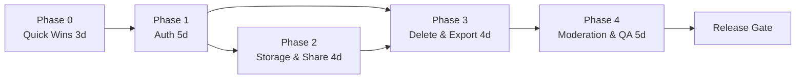

# 隐私安全待办拆分（Backlog）

| 项 | 内容 |
| --- | --- |
| 目标 | 把 [验收测试](13-acceptance-test-plan.md) 中所有 ❌ 转为 ✅，使 v1 达到可发布门槛 |
| 口径 | 1 人全职开发估算；含自测，不含评审等待 |
| 总量 | P0 ≈ 20 人日，P1 ≈ 14 人日，P2 另计 |

> **执行进度（2026-11-05）**：P0-01/02/03 完成；P1-01 登录、P1-02 限流、P1-03 body 同意、P1-04 删除/导出/撤回、P1-05 本地签名 URL、P1-06 分享副本、P1-09 Origin/SSRF、P1-10 审计、P1-12 health/config 完成。剩余 **P1-08 图片审核 + 管理后台**、**P1-11 任务编排统一**、S3/CSP/Redis/训练合同。详见 [安全加固记录](15-security-hardening.md)。

---

## 1. 优先级

| 级别 | 定义 | 处理 |
| --- | --- | --- |
| **P0** | 阻塞发布：无鉴权、无限流、删不干净、授权不合规、私图公开 | 本迭代必须完成 |
| **P1** | 上线后 30 天内：导出、找回密码、保留期、后台 UI、监控 | 排入下一迭代 |
| **P2** | 合规增强：DPIA、渗透测试、多区域、等保 | 上线后 90 天 |

---

## 2. 里程碑与依赖

- Phase 0 可并行做，不等 Auth。
- Auth 是所有"按用户限流/删除账号/归属校验"的前置。
- 签名 URL 依赖存储驱动改造；分享公开副本依赖签名 URL 的公开读能力。

---

## 3. P0 任务

### Phase 0 · Quick Wins（3 人日）

| ID | 任务 | 具体改动 | 验收 | 估算 |
| --- | --- | --- | --- | --- |
| P0-01 | 全身照服务端同意 | `upload.service.ts` 对 `kind=body` 校验 `consent=true`，写 `Consent(FULL_BODY_PROCESSING)`；补枚举值 | 无 consent 的 body 上传 403；`consents` 有记录 | 0.5d |
| P0-02 | 删除单张生成结果 | 新增 `DELETE /api/media/:id`（owner，仅 RESULT）；清理 `Outfit.resultImageId/coverImageId`；写审计 | 删除后 404，方案不悬挂引用 | 1d |
| P0-03 | 进程内限流 | `server/http/rate-limit.ts` 固定窗口/令牌桶；覆盖登录/上传/生成/发帖/评论；返回 429 + 头 | 1 分钟 100 次评论被限；正常请求不受影响 | 1d |
| P0-04 | Origin / SSRF 加固 | 写接口校验 Origin；图片 URL 拒绝私网 IP/`file:`/`data:`；DNS 解析后校验 | 伪造 Origin 403；`http://127.0.0.1` 422 | 0.5d |

### Phase 1 · 真实鉴权（5 人日）

| ID | 任务 | 验收 | 估算 |
| --- | --- | --- | --- |
| P0-05 | Auth.js 邮箱登录/注册/登出 | 会话 Cookie HttpOnly/Secure/SameSite；未登录写接口 401；`requireUser` 返回真实用户 | 2d |
| P0-06 | 替换演示身份 | 删除 `DEMO_USER_EMAIL` 分支；所有 ownerId 来自会话；种子账号可登录 | 1d |
| P0-07 | 登录安全 | bcrypt cost=12；连续 5 次失败锁 15 分钟；登录限流；会话 30 天滑动 | 1d |
| P0-08 | 权限矩阵测试 | 他人 media/outfit/post 404；管理接口 403；作者可编辑 | 1d |

### Phase 2 · 存储与分享（4 人日）

| ID | 任务 | 验收 | 估算 |
| --- | --- | --- | --- |
| P0-09 | S3 私有桶驱动 | 本地存储抽象切换 S3；Bucket 禁止公共读；对象 key 不可枚举 | 1.5d |
| P0-10 | 签名 URL | `GET /media/:id/url` 返回 60s 签名；敏感图 `no-store`；前端改用签名 | 1d |
| P0-11 | 分享公开副本 | 分享时把结果复制为 `POST_IMAGE`（用户确认）；帖子只引用公开副本 | 1.5d |

### Phase 3 · 删除、导出、审计（4.5 人日）

| ID | 任务 | 验收 | 估算 |
| --- | --- | --- | --- |
| P0-12 | 删除账号 | 软删 30 天 + 登录失效 + 对象前缀清理任务；到期物理删除 | 1.5d |
| P0-13 | 撤回授权 | `POST /consents/:id/revoke`；停止新任务；异步删除该用户 FACE 媒体；UI 隐私中心入口 | 1.5d |
| P0-14 | 数据导出 | `DATA_EXPORT` 异步任务生成 JSON 压缩包，24h 签名链接 | 1d |
| P0-15 | 审计补齐 | 授权/撤回/删除/分享/登录写 `AuditLog`，管理端可查 | 0.5d |

### Phase 4 · 审核与验收（5 人日）

| ID | 任务 | 验收 | 估算 |
| --- | --- | --- | --- |
| P0-16 | 图片审核 Provider | 接入内容安全服务；REVIEW/BLOCK 落库；失败降级人工 | 1.5d |
| P0-17 | 管理后台 UI | 举报队列、下架/恢复、敏感词、审计查询 | 2d |
| P0-18 | 自动化验收 | Playwright：授权→上传→生成→保存；发帖→举报→下架；未登录/限流/删除 | 1d |
| P0-19 | 隐私文案与页面 | `/legal/privacy`、`/legal/terms`、`/legal/consent`；授权弹层链接 | 0.5d |

---

## 4. P1 任务（上线后 30 天）

| ID | 任务 | 验收 | 估算 |
| --- | --- | --- | --- |
| P1-01 | 密码重置 / 邮箱验证 | 邮件 token 15 分钟有效；重置后旧会话失效 | 2d |
| P1-02 | Redis 限流 | 多实例共享；滑窗；按用户+IP | 1d |
| P1-03 | 保留期任务 | 每日清理 180 天照片、24h 未完成上传、90 天通知 | 1d |
| P1-04 | 训练 opt-out 合同化 | Provider 请求带字段；供应商清单/DPA 归档；年度复核 | 1d |
| P1-05 | 监控告警 | 生成失败率、429 比例、删除任务失败、异常登录 | 1.5d |
| P1-06 | 备份与恢复演练 | 备份加密；恢复演练记录；删除传播到备份 | 1d |
| P1-07 | 安全头/CSP | HSTS、CSP、Referrer-Policy；`npm audit` 0 high | 1d |
| P1-08 | 未成年人门槛 | 年龄声明；未成年人限制生成/分享 | 1d |
| P1-09 | 管理后台权限细化 | 审核员/超管分权；操作二次确认 | 1.5d |

---

## 5. P2 任务（90 天）

| ID | 任务 | 说明 |
| --- | --- | --- |
| P2-01 | 渗透测试 | 越权、SSRF、上传、Webhook 重放、限流绕过 |
| P2-02 | DPIA / 隐私影响评估 | 人脸生物识别、数据出境、供应商 |
| P2-03 | 等保/ISO 27001 准备 | 资产清单、访问评审、应急响应 |
| P2-04 | 多区域与数据驻留 | 人脸数据不出境；区域化 Bucket/DB |
| P2-05 | 密钥轮换 | KMS 自动轮换；历史数据重加密 |

---

## 6. 建议排期

| 周 | 内容 | 出口 |
| --- | --- | --- |
| W1 | Phase 0 + Auth 前半 | 限流/Origin/body 同意可用；登录页可登录 |
| W2 | Auth 完成 + S3/签名 URL | 未登录 401；私有图只能签名访问 |
| W3 | 分享公开副本 + 删除账号/结果 | PS-09/11/12 转 ✅ |
| W4 | 撤回/导出/审计 + 图片审核 | PS-14/21/24/25 转 ✅ |
| W5 | 管理后台 + Playwright + 文案 | 验收全绿，Release Gate |

---

## 7. Definition of Done（每个任务）

- [ ] 代码合并，`pnpm typecheck && pnpm test && pnpm build` 通过。
- [ ] 新增/修改接口有 Zod 校验、鉴权、错误码、限流。
- [ ] 对应验收用例从 ❌/⚠️ 变 ✅，并附执行记录。
- [ ] 涉及敏感数据：加密/可见性/删除/审计四件事齐全。
- [ ] 文档（API/隐私/环境变量）同步更新。
- [ ] 代码评审通过（至少 1 人，安全相关 2 人）。

---

## 8. 风险与决策点

| 风险 | 影响 | 建议 |
| --- | --- | --- |
| Auth 改造触碰所有路由 | 回归范围大 | 先加 `requireUser` 统一入口，再替换实现；保留 E2E 基线 |
| S3 签名 URL 改动前端图片加载 | 多处 `` | 统一 `useMediaUrl` hook，后端返回签名 URL 而非路径 |
| 删除账号涉及对象存储/备份 | 删不干净 | 先软删 + 前缀清理任务；备份生命周期单列 P1 |
| 第三方图片审核成本 | 成本/延迟 | 先抽样/异步审核，命中再转人工 |
| 分享公开副本与隐私冲突 | 用户照片被公开 | 只复制“生成结果”，不复制原图；分享弹窗明确告知 |

---

## 9. 最小可发布集合（如果只能做 5 件事）

1. **P0-05/06 真实登录**（否则所有权限都是假的）。
2. **P0-03 限流**（防刷/防撞库）。
3. **P0-01 body 同意 + P0-13 撤回**（合规硬门槛）。
4. **P0-12 删除账号 + P0-02 删除结果**（删除权）。
5. **P0-11 分享公开副本**（避免私图 404/泄露）。

完成这 5 项后，再补签名 URL、图片审核、管理后台，即可进入发布候选。
